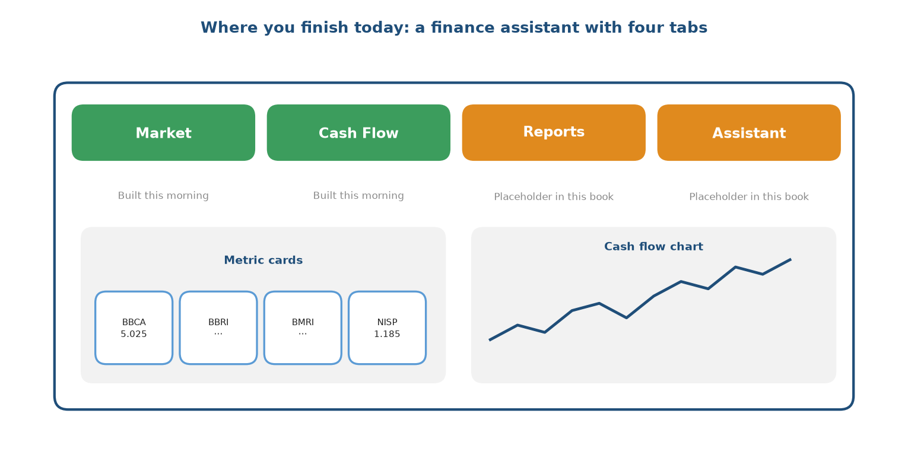
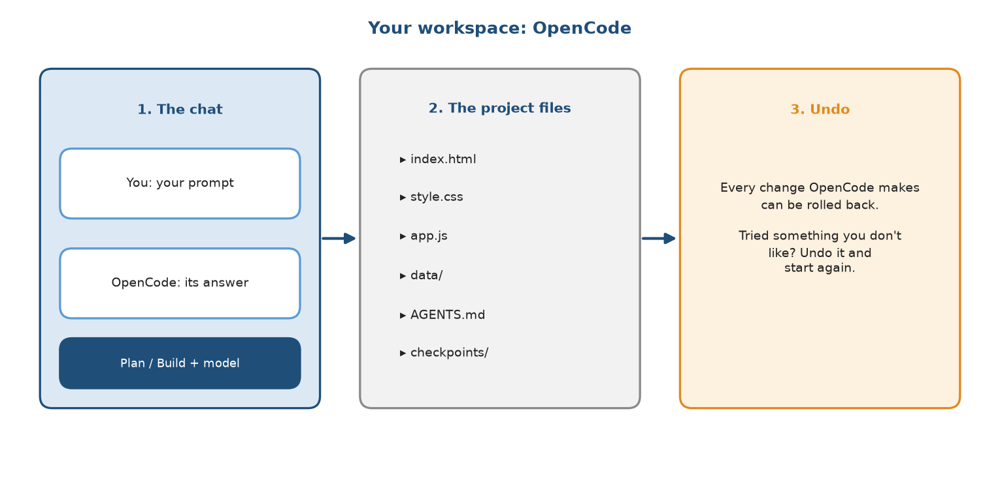

**Learning objectives.** See where the day ends, find your way around OpenCode, tell its two agents apart, watch what a vague prompt produces, and learn the two dials that control the AI: the model and the thinking effort.

You will build a **finance assistant** for **Harapan Mitra Niaga**, a fictional company, by talking to an AI coding agent. You never write code by hand. You describe, the AI builds, you check. Nothing in this course is investment advice: the stock data is for practice only.

## 0.1 Today's finish line

Think of a house builder who shows you the finished show-home before you pick up a single brick. Everyone then knows what they are building. By the end of the day your app has four **tabs** (the clickable labels at the top of a page): Market, Cash Flow, Reports and Assistant.

<Frame caption="Figure 0.1: the finished app. Green tabs are built in this book; orange tabs are placeholders until later sessions.">
  
</Frame>

## 0.2 Your workspace: OpenCode

**OpenCode** is the AI coding agent you will talk to all day. It has three things worth knowing.

<Frame caption="Figure 0.2: the chat, the project files and the undo safety net.">
  
</Frame>

▶ **Do it:** open OpenCode in the starter folder. Find the **chat** (where you type) and the list of **files** OpenCode changes. To **undo** a change, press `ctrl+x` then `u` (a message and its file changes are removed); `ctrl+x` then `r` brings it back. Undo works because the starter kit folder is a Git repository.

OpenCode has two **agents**, and you choose which one to talk to. An agent is the mode the AI works in.

| Agent | Think of it as | What it does | Changes your files? |
|----|----|----|----|
| **Plan** | A **consultant**: advises, hands off | Reads your project, thinks, and writes a plan | No, never |
| **Build** | A **contractor**: builds, hands on | Edits files and runs commands | Yes |

A simple rule: **Plan to think, Build to do.** When Build finishes, read its summary to see which files it changed. If it asks permission to run a command, read the command first.

▶ **Do it:** press `Tab` to switch between the two agents (`Shift+Tab` goes back). Do it once so you know where the switch is. Press `ctrl+x` then `n` to start a **new chat**: you will do this often.

## 0.3 Try it with a vague prompt

Now see what the contractor does when you give almost nothing to go on.

▶ **Do it:** press `ctrl+x` then `n` for a **new chat**, press `Tab` to choose the **Build** agent, and send:

> **Build me a finance app**

Watch it work. It plans, creates files, and may ask to run a command. When it stops, answer: what did it build? Which decisions did it make for you (the look, the data, the numbers)? Then compare screens with your neighbours.

**What to look for:** something that probably runs, built from guesses. Your neighbour's app is different from yours, even though you typed the same words. The AI made every decision because you made none.

**The lesson: vague in, mess out.** **Keep this prompt.** In Session 2 you will rewrite it and compare the results.

▶ **Do it:** undo the change: press `ctrl+x` then `u`. Repeat until the folder is back to the starter. Check that your files look the same as before the Build run.

## 0.4 Model and thinking effort

You have two dials. The **model** is which AI does the work. The **thinking effort** is how hard it thinks before answering. More thinking means more effort, and more effort costs more.

| Job | Effort | Why |
|----|----|----|
| Planning a new feature | Higher | A mistake in the plan spreads into everything after it |
| Fixing a tricky problem | Higher | The cause is hidden, so the AI needs to reason |
| A small edit (change a colour, fix a label) | Lower | Little thinking is needed, so save the cost |

▶ **Do it:** press `ctrl+x` then `m` to open the list of **models** and see what is available. Close it without changing anything. Then press `ctrl+t` to cycle through the **variants** of the current model: this is how you change the thinking effort. Look at the chat box to see which one is active, and leave it on the setting your trainer gives you.

**Bridge to Session 1:** why does thinking harder cost more? To answer that, we need to know what this AI actually is.
