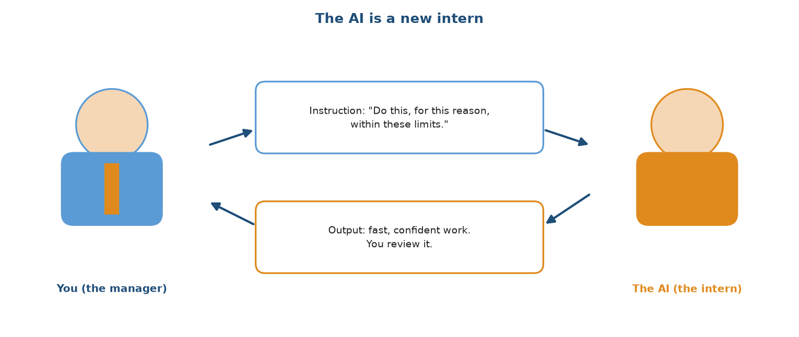
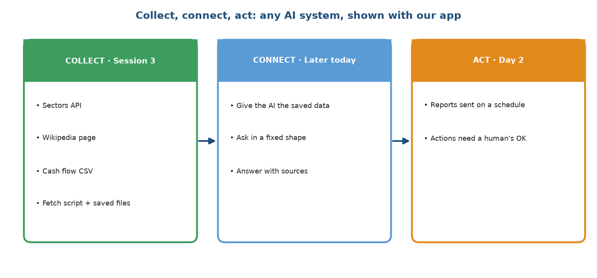

**Learning objectives.** Explain in your own words what a model, a thinking effort and a token are, using one analogy: the AI is an intern. Then place every part of our app on a simple map and learn the guardrails.

## 1.1 What is an AI?

Picture a new intern on your team. They work fast, they never complain and they sound very sure of themselves. But they do not know your company, and they do only what you ask. The AI we use is a **model** that talks in human language, and it behaves like that intern. **Its output depends on the instruction you give.**

<Frame caption="Figure 1.1: you are the manager; the AI is the intern.">
  
</Frame>

That is why you are not out of a job. You decide what to build, you give clear instructions, and you review the work.

## 1.2 What does changing the model mean?

Choosing a different model is **hiring a different intern**. Each intern has different capabilities and puts a different amount of effort into understanding and carrying out your instructions.

| Intern (model) | Capability | Speed | Cost | Good for |
|----|----|----|----|----|
| Smaller, lighter | Less capable | Faster | Cheaper | Small edits and quick questions |
| Mid-size | Balanced | Medium | Medium | Most everyday building |
| Largest, most careful | More capable | Slower | More expensive | Planning and hard problems |

Model names change often, so judge a model by where it sits in this table, not by its name.

## 1.3 Thinking effort and tokens

A more complex task, or a higher thinking effort, makes the intern spend more **energy**. In AI, that energy is counted in **tokens**. A token is a small piece of text, roughly a short word or part of one. The AI reads tokens (your prompt and the files it looks at) and writes tokens (its answer). More tokens means more cost.

This answers the question from 0.4. Thinking harder means more tokens, and tokens cost money. So a higher effort is worth it for planning and tricky fixes, and wasteful for small edits.

## 1.4 Interns get tired

An intern who has been talking with you all day starts to forget what you said this morning. The AI does the same. Every chat has a limited **memory**, and a very long chat fills it. When that happens, early instructions get lost and the AI starts to contradict itself.

Two practical rules follow:

1\. **Start a new chat for each feature.** A fresh chat is a rested intern.

2\. **Keep lasting decisions in a file called `AGENTS.md`.** It is the project's briefing note, which OpenCode reads every time. You write it in Session 2.

## 1.5 Collect, connect, act

Every AI system, big or small, does three things. It **collects** data, **connects** that data to the AI, and **acts** on the result. Our app is the example.

<Frame caption="Figure 1.2: our app&#x27;s parts, placed in the three stages.">
  
</Frame>

| Stage | In plain words | In our app | When |
|----|----|----|----|
| **Collect** | Gather the numbers | Sectors, Wikipedia and the cash flow CSV, saved as files | Session 3 (this morning) |
| **Connect** | Give the data to the AI | The AI reads the saved data and answers with sources | Later today |
| **Act** | Do something with the answer | Scheduled reports and actions a human approves | Day 2 |

## 1.6 Guardrails

A **guardrail** is a rule that keeps the system safe. We use three:

| Guardrail | In plain words |
|----|----|
| **Reading is safe; acting needs approval** | The AI may look at data freely. Anything that changes something real needs a human to say yes first. |
| **Keys stay secret** | Your API key is a membership card. It lives in one private file and is never typed into a chat or shown on a page. |
| **Public data only** | Use public market data and made-up company data. Never paste real customer or internal records into a prompt. |
