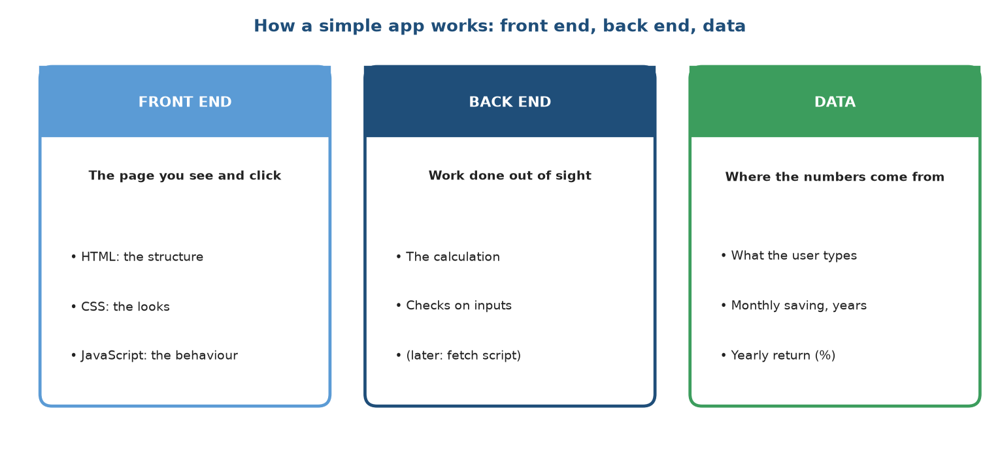
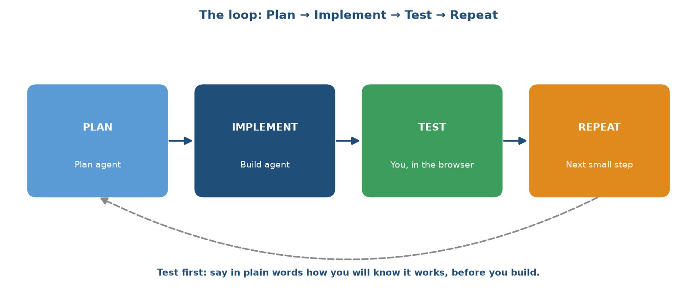

**Learning objectives.** Say why the vague prompt failed, name the three parts of an app, write a better prompt and run it, work through the Plan → Implement → Test → Repeat loop (starting with an interview), and turn the loop into reusable skills. Today's use case is a simple web page that works only with what the user types in: no outside data yet.

## 2.1 Back to the vague prompt

Look again at "Build me a finance app" from Session 0. Why did it fail? The AI had to guess **every** decision: what the app does, how it looks, what it calculates, and what must not break. Each guess was reasonable, and each was different from your neighbour's. To make those decisions yourself, you first need to know what an app is made of.

## 2.2 How an app works: front end, back end, data

Think of a restaurant. The **dining room** is what guests see. The **kitchen** does the work out of sight. The **pantry** holds the ingredients. Every app has the same three parts.

<Frame caption="Figure 2.1: a simple savings calculator, split into front end, back end and data.">
  
</Frame>

Our practice app for this session is a **savings goal calculator**: you type how much you save each month, for how many years, and the yearly return you expect, and it shows what you will have at the end.

| Part | In plain words | In the savings calculator | What to tell the AI |
|----|----|----|----|
| **Front end** | The page you see and click (the dining room) | One web page built from HTML, CSS and JavaScript: three input boxes, a button and a result | "One page, three boxes, a Calculate button, the result under it. Clean and light." |
| **Back end** | Work done out of sight (the kitchen) | The calculation, and the checks on what you typed | "Work out the final amount. Show a friendly message if a box is empty or negative." |
| **Data** | Where the numbers come from (the pantry) | Only what the user types into the boxes. Nothing is fetched yet | "The only data is the three numbers the user types. Save nothing." |

The front end is made of three languages. You will not write them, but you should know the jobs:

| Language | Its job | Analogy |
|----|----|----|
| **HTML** | The structure: headings, boxes, buttons | The skeleton of a building |
| **CSS** | The looks: colours, spacing, fonts | The paint and furniture |
| **JavaScript** | The behaviour: what happens when you click | The wiring and the light switches |

## 2.3 Refine the prompt, then run it

Now rewrite the vague prompt using the three parts. Keep it simple: you do not need to describe every detail.

▶ **Do it:** press `Tab` until the **Plan** agent is active, press `ctrl+x` then `n` for a new chat, and send:

> **I want a simple savings goal calculator web page for a finance team. Make a plan only.**
>
> Front end: one plain HTML, CSS and JavaScript page. Three input boxes (monthly saving in rupiah, number of years, expected yearly return in percent), a Calculate button, and the result shown underneath. Clean, light look.
>
> Back end: the page works out the final amount, and shows a friendly message if a box is empty or negative.
>
> Data: only what the user types. Do not fetch or save anything.
>
> Limits: no investment advice, and nothing beyond this one page.
>
> Don't build yet.

**What to look for:** a numbered plan with front end, back end and data parts, **no files changed**, and no features you did not ask for. Compare it with what you got in 0.3: this time the AI is working from **your** decisions, not its own.

A plan on paper is not an app. **Run it before you go any further.** Read the plan, then approve it.

▶ **Do it:** press `Tab` to switch to the **Build** agent and send:

> **The plan looks good. Build it.**
>
> Then start a simple local server and tell me the address to open in my browser.

▶ **Do it:** open the address OpenCode gives you in your browser, and try the calculator.

**What to look for:** (1) three input boxes, a Calculate button and a result area; (2) type **1000000** as the monthly saving, **10** years and **0**% return: the result is exactly **Rp 120.000.000** (120 months × Rp 1.000.000); (3) change the return to **6**%: the result is higher, roughly **Rp 164 million** if it compounds monthly. Ask the AI which formula it used; (4) leave a box empty and click Calculate: you see a friendly message, not a blank result or a crash.

Compare this with your Session 0 app. Same tool, but this time **you** made the decisions. Now let's build the habit that makes this repeatable.

## 2.4 The loop

Every feature you build from now on goes round the same four steps. It is a small loop on purpose: one piece at a time, so when something breaks you know which step did it.

<Frame caption="Figure 2.2: the loop, with test first.">
  
</Frame>

| Step | OpenCode agent | What you do | Done when |
|----|----|----|----|
| **Plan** | Plan | Let the AI **interview you** about the system, then read and approve the plan | The brief is complete and you agree with every step in the plan |
| **Implement** | Build | Tell it to build one step, described as front end, back end and data | Build's summary lists the files it changed |
| **Test** | You, in the browser | Check the result against what you wrote down first | Every check you listed passes |
| **Repeat** | Plan again | Pick the next small feature | All the checks pass |

We will run one turn of the loop by hand. The feature: a **table that shows the balance at the end of each year**.

## 2.5 Plan: let the AI interview you

A good teammate asks questions before acting. In the Plan step, you do not write the plan yourself. You let the AI interview you about the system you want to build, one question at a time, until it understands.

▶ **Do it:** press `Tab` for the **Plan** agent, press `ctrl+x` then `n` for a new chat, and send:

> **Interview me about the system I want to build: a yearly breakdown for my savings calculator.**
>
> Ask one question at a time. Cover three areas: the front end (what the user sees and does), the back end (what is calculated and checked) and the data (what goes in and what comes out).
>
> Don't write any code until I say the brief is complete.

**What to look for:** one question at a time, no files changed, questions about all three parts (front end, back end, data), and when you say "the brief is complete" it hands back a short written brief you can read in a minute.

**Test first.** Before you build, write down in plain words how you will know it works. For example: "With Rp 1.000.000 a month for 3 years at 0%, the table has 3 rows, and the balances are Rp 12.000.000, Rp 24.000.000 and Rp 36.000.000." Write the check before the work, and you will not argue yourself into thinking a half-done job is fine.

▶ **Do it:** still in the Plan agent, ask for the plan, using your test:

> **The brief is complete. Now write a step-by-step plan.**
>
> Include this test: with Rp 1.000.000 a month for 3 years at 0%, the table shows 3 rows with balances of Rp 12.000.000, Rp 24.000.000 and Rp 36.000.000.
>
> Don't build yet.

**What to look for:** a short plan, with your test written into it, and no files changed.

## 2.6 Implement, test, repeat

Now the contractor builds. Notice that the prompt uses the same three parts you have learned: front end, back end, data.

▶ **Do it:** press `Tab` for the **Build** agent and send:

> **Implement the plan we agreed: the yearly breakdown table.**
>
> Front end: under the result, add a table with one row per year, with the columns year, total saved, total growth and balance.
>
> Back end: work out each year's numbers using the same calculation as the result. The last row must match the result.
>
> Data: only the three numbers the user typed. Save nothing.
>
> Don't change anything else on the page.

▶ **Do it:** **test** it. Run your test from 2.5.

**What to look for:** (1) the table appears under the result after you click Calculate; (2) for Rp 1.000.000 a month, 3 years, 0%: **3 rows** with balances **Rp 12.000.000, Rp 24.000.000 and Rp 36.000.000**; (3) the **last row's balance equals the result** above; (4) the three boxes and the button still work as before.

If a check fails, do not rewrite the prompt from scratch. Tell Build exactly which check failed and what you saw, and repeat. That is the **Repeat** step.

## 2.7 From loop to skills: Superpowers

Everything you just did by hand can run automatically as **skills**. A **skill** is a saved recipe the AI follows. **Superpowers** is the set of skills we use today.

| Skill | Step it automates | In plain words |
|----|----|----|
| **brainstorming** | The interview | The AI asks you questions first |
| **writing plans** | The plan | The AI writes a step-by-step plan for you to approve |
| **executing plans** | The build | The AI builds the plan one step at a time |
| **test-driven development** | Test first | The AI writes the check before the feature |

▶ **Do it:** with the Superpowers skills added (see Appendix A) and OpenCode restarted, ask for the next feature. Notice that you still describe it in front end, back end and data:

> **Add a feature to the calculator: show how much of the final amount is what I saved and how much is growth.**
>
> Front end: two labelled amounts and a percentage under the result, for example "You saved: ... Growth: ... (xx% of the total)".
>
> Back end: saved = monthly saving × months; growth = final amount − saved. Handle 0% return (growth is 0).
>
> Data: only the three numbers the user types.
>
> Use the skills: interview me only if you need to, plan it, then build it and test it.

**What to look for:** notice how little you type. The AI plans, builds and checks by itself, and asks you to approve the plan. With Rp 1.000.000 a month, 10 years and 0%: saved **Rp 120.000.000**, growth **Rp 0** (0%).

▶ **Do it:** save the brief and the plan as files, and write the project rules into `AGENTS.md`. Send to **Build**:

> **Save the brief as docs/brief.md and the plan as docs/plan.md. Then write AGENTS.md with these project rules:**
>
> Describe every feature as front end, back end and data before building.
>
> Plain HTML, CSS and JavaScript only. Do not add extra features I did not ask for.
>
> Always show a note that the app gives no investment advice.
>
> Use one ticker format: NISP, never NISP.JK.
>
> For later: the API key lives only in .env and is never shown in the browser; the web page reads only saved files.

**What to look for:** three files exist (`docs/brief.md`, `docs/plan.md`, `AGENTS.md`), and `AGENTS.md` lists the rules in your own words.
