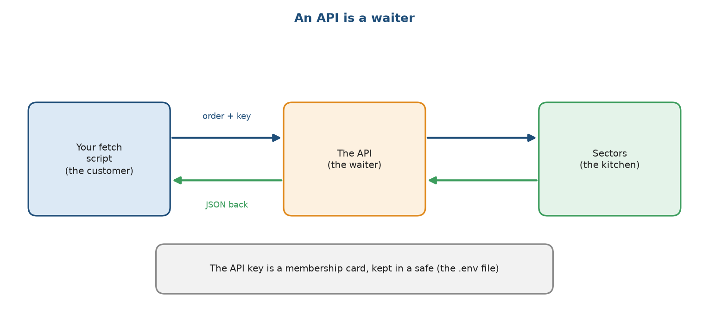
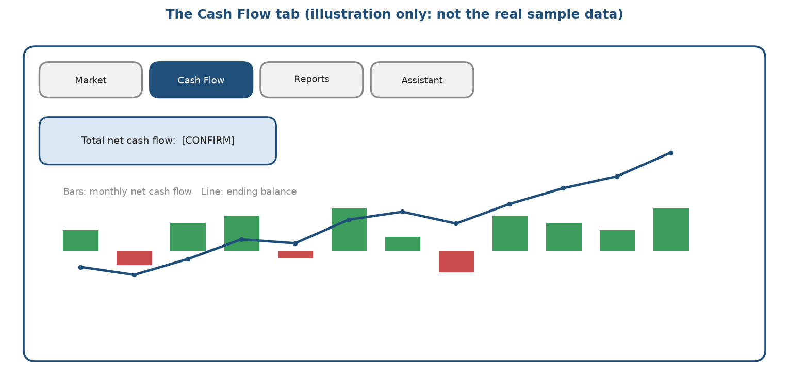
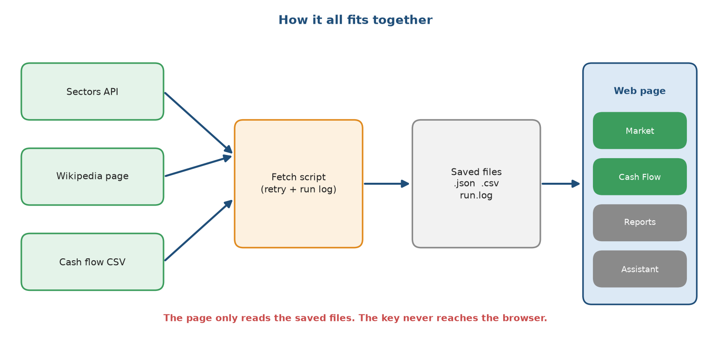

**Learning objectives.** Turn the page into the app shell, pull data from three kinds of source (an API, a public web page and an internal file), show each on the page, and learn how to keep the data trustworthy when things go wrong.

One idea frames this whole session: **data sets the limit of any AI system, and most errors are data errors.** If the numbers are wrong, nothing built on top can be right. Each source below follows the same order: **concept, hands-on, show it on the page.**

## 3.0 Start: turn the calculator into the app shell

Your page from Session 2 is a calculator. The capstone app has four tabs. Keep the calculator safe in its own file, and make the main page the empty four-tab shell. Use the same three parts: front end, back end, data.

▶ **Do it:** press `Tab` for the **Build** agent, press `ctrl+x` then `n` for a new chat, and send:

> **Turn the project into the app shell for a finance team assistant.**
>
> Front end: keep the calculator as calculator.html. Make index.html a page with four tabs: Market, Cash Flow, Reports, Assistant. Clicking a tab shows its title and the text "Coming soon". Clean, light look.
>
> Back end: nothing yet.
>
> Data: nothing yet.
>
> Then start a simple local server and tell me the address to open. Don't add anything else.

**What to look for:** (1) four tabs across the top; (2) clicking each tab shows its own title and "Coming soon"; (3) the calculator still works at `calculator.html`; (4) OpenCode gave you an address to open.

## 3.1 Source 1: an API (Sectors)

**Concept.** An **API** is a waiter. You (the fetch script) place an order, the waiter takes it to the kitchen (Sectors) and brings back the food (the data). To be served, you show a membership card: your **API key**. Keep it in a safe, a private file called **`.env`**, and never leave it on the table. The data comes back as **JSON**, a tidy text format that programs can read.

<Frame caption="Figure 3.1: the API is a waiter, and the key is your membership card.">
  
</Frame>

Every reply carries a **status code**, a number that tells you how the order went:

| Plain words | What it means | What to do |
|----|----|----|
| OK | It worked | Use the data |
| Wrong key | Your card was refused | Stop. Fix the key. Do not show old data |
| Not found | No such ticker or page | Check the spelling |
| Try again later | The service is busy | Wait, then retry |

**Hands-on.** A **ticker** is the short code for a listed company, such as BBCA. The fetch script is a small program OpenCode writes for you. You describe it; you do not read it.

▶ **Do it:** start a new **Build** chat and send:

> **Write a fetch script that gets data from the Sectors API for four IDX banks: BBCA, BBRI, BMRI and NISP.**
>
> For each one, save the company info and the last 30 days of daily closing prices as JSON files in the data folder.
>
> Read the API key from .env. Never print it or put it in any file the web page can read.
>
> If the key is wrong, stop and print a clear error message. Do not fall back to old data.
>
> Use the ticker format NISP, never NISP.JK. Then run the script and tell me which files it created.

**What to look for:** (1) four price files and four company files appear in `data/`; (2) each price file has about 20 trading days; (3) `.env` is not copied anywhere else. Now test the failure: put a wrong key in `.env`, run it again, and check you get a **clear error**, not old data. Put the right key back.

**Show it.** Now make the page use the files.

▶ **Do it:** send to **Build**:

> **On the Market tab, add a ticker dropdown with BBCA, BBRI, BMRI and NISP.**
>
> Below it, show three metric cards for the chosen ticker: company name, last close in rupiah, and daily change in percent.
>
> Read only the saved files in data/. Do not call the internet from the page.

**What to look for:** NISP's last close on 23 Oct 2026 is **Rp 1.185** and BBCA's is **Rp 5.025**. As a check on the daily change for that day: NISP rose Rp 5 (about +0.4%) from Rp 1.180, and BBCA fell Rp 150 (about −2.9%) from Rp 5.175. The Market tab's "last close" shows the most recent day in your files, so find 23 Oct in the saved file to compare. Prices verified against Sectors on 7 Nov 2026.

## 3.2 Source 2: a public web page (Wikipedia)

**Concept.** **Scraping** means reading a public web page with a program instead of by eye. Do it politely, in three ways: (1) check that the site allows it; (2) identify yourself honestly in the request; (3) take only what you need, and do not hammer the site with requests.

**Hands-on.** Wikipedia's page \*List of banks in Indonesia\* has a section called "State-owned". It lists the banks the government owns. We read only that table.

▶ **Do it:** send to **Build**:

> **Extend the fetch script to read the "State-owned" table on Wikipedia's page "List of banks in Indonesia".**
>
> Save the bank names and their founding dates as data/state_owned_banks.csv.
>
> Be polite: identify the script with a clear name in the request, make one request per run, and take only that table.
>
> Run it and tell me how many banks it saved.

**What to look for:** `data/state_owned_banks.csv` exists with the **state-owned banks**: Bank Mandiri, Bank Negara Indonesia (BNI), Bank Rakyat Indonesia (BRI) and Bank Tabungan Negara (BTN). Wikipedia can change, so a different row count is possible: if so, open the page and compare.

**Show it.**

▶ **Do it:** send to **Build**:

> **On the Market tab, under the cards, add a table of the state-owned banks from data/state_owned_banks.csv.**
>
> Mark the ones that are in our four tickers.

**What to look for:** a table with the banks above. Of our four tickers, **BMRI (Bank Mandiri) and BBRI (Bank Rakyat Indonesia)** appear in the table and should be marked. **BBCA and NISP are private banks and should not be marked.** BNI and BTN are state-owned but are not among our four tickers.

## 3.3 Source 3: internal data (the cash flow CSV)

**Concept.** **Internal data** is the company's own records. It never leaves the building, and you cannot fetch it from the internet. A **cash flow statement** shows the money that moved in a period: **cash in** (money received), **cash out** (money spent), **net cash flow** (in minus out) and the **ending balance** (what is left). It is your household budget, but for a company.

Your file is a **CSV** (comma-separated values): a simple table saved as text that any spreadsheet can open. It is `data/cash_flow_sample.csv` and has one row per month for 12 months (Nov 2025 to Oct 2026) with these columns: `month`, `cash_in`, `cash_out`, `net_cash_flow` and `ending_balance`. All amounts are in rupiah. The first month is Nov 2025 (net Rp 130.000.000) and the last is Oct 2026 (ending balance Rp 3.330.000.000). It belongs to the fictional company Harapan Mitra Niaga.

▶ **Do it:** open `data/cash_flow_sample.csv` in a spreadsheet and add up the **net cash flow** column by hand. Write the total down. You will use it as your check.

**Hands-on and show it.** The page reads the CSV directly. There is no fetch script here, because the file is already on your computer.

▶ **Do it:** send to **Build**:

> **On the Cash Flow tab, read data/cash_flow_sample.csv.**
>
> Show a chart with the monthly net cash flow as bars and the ending balance as a line. Show the total net cash flow for the year above the chart.
>
> Label the axes and format numbers with thousands separators.

**What to look for:** a chart with 12 months; bars up when net cash flow is positive and down when negative; a line for the ending balance; and a **total equal to your hand-added total: Rp 1.330.000.000**. Two months are negative (Jan 2026 at −Rp 30.000.000 and Apr 2026 at −Rp 60.000.000), so two bars point down. If the two totals differ, the page is wrong, not your sum.

<Frame caption="Figure 3.2: the Cash Flow tab (an illustration of the layout, not the sample data).">
  
</Frame>

## 3.4 How it all fits together

Step back. Three different sources now flow through one pipeline into the page.

<Frame caption="Figure 3.3: three sources → fetch script → saved files → web page tabs.">
  
</Frame>

Three ideas apply to the whole layer.

**1. Trustworthy records.** Every number should be traceable and consistent: **one ticker format** (`NISP`, never `NISP.JK`), **raw units** (store 1185, not "Rp 1.185 per share"), and **where and when** each number came from.

**2. When things fail.** Data fails in four ways. Each has a response, and each has a **test first** check you can write in one sentence:

| Failure | Plain words | Response | Test first |
|----|----|----|----|
| **Temporary** | A blip, such as "try again later" | **Retry** | "If Sectors says try again later, the script waits and tries again, then succeeds." |
| **Permanent** | Wrong key, wrong ticker | **Stop** | "A wrong key stops the script with a clear message." |
| **Incomplete** | Some rows are missing | **Mark it** | "If a ticker returns no prices, the page says so, not zero." |
| **Silent** | Wrong data with no error | **Prevent it** | "The script refuses to save prices that are zero or negative." |

**3. The run log.** A **run log** records one line for every run: when it ran, what it fetched and whether it worked. It is the first place to look when numbers on the page look odd.

▶ **Do it:** send to **Build**:

> **Add two things to the fetch script.**
>
> A retry rule: if the service says to try again later, wait a few seconds and try up to three times. Do not retry on a wrong key or an unknown ticker.
>
> A run log: append one line to data/run.log on every run, with the time, how many tickers were fetched, and OK or FAILED.
>
> Run the script twice and show me the log.

**What to look for:** `data/run.log` has **exactly two new lines** after two runs, each with a time, a ticker count of 4 and OK. Next, put a wrong key in `.env` and run once more: a third line says FAILED and the script did not retry. Put the right key back.
