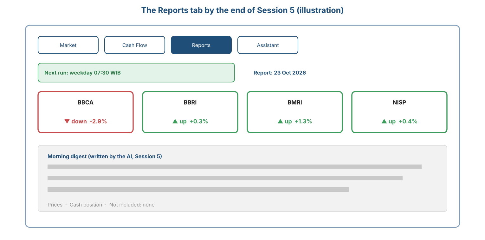

**Learning objectives.** Turn the fetch script into a job that runs on its own every weekday morning, build the Reports tab, and learn what makes a scheduled job safe: a clear trigger, a stated time zone, a report that survives one failure, and a log line for every run.

**Where we left off.** The app can fetch and save data, but only when someone runs the fetch script by hand. A finance team needs the numbers ready before they sit down, and a person pressing a button every morning will forget. In this session the person goes away and the job stays.

## 4.0 Start: add the news to the fetch script

Sessions 5 and 6 need news: the AI digest uses it to explain the numbers, and the Assistant answers from it. The starter kit already holds a saved copy in `data/news/`: 20 articles per bank, saved from Sectors on 25 Oct 2026. Most were published between 20 and 25 October, just after bank shares fell sharply on 16 and 19 October, while they bounced back. Everyone starts from the same articles, so everyone's answers can be checked against the same facts.

Now teach the fetch script to add new articles to that archive, without losing the old ones.

▶ **Do it:** press Tab for the **Build** agent, press `ctrl+x` then `n` for a new chat, and send:

> **Extend the fetch script to get the latest news for BBCA, BBRI, BMRI and NISP from the Sectors API.**
>
> Front end: nothing yet.
>
> Back end: add the new articles to the saved news in data/news/, one file per ticker. Keep every article that is already there. Never save the same article twice: an article with the same title and date is the same article.
>
> Data: for each article keep the title, date, source link, tickers and text.
>
> Run the script twice and tell me how many articles each file has after each run.

**What to look for:** (1) each file in `data/news/` still has its October articles; (2) the counts after the second run are the **same** as after the first: running twice did not add copies; (3) the run log from 3.4 has two new lines. If Sectors is unreachable today, the October archive is still there, and Sessions 5 and 6 still work.

You have just met the most important idea of this session without its name: **running the job twice gives the same result**. Keep that in mind for 4.2.

## 4.1 A conveyor on an alarm clock

Think of a factory conveyor belt with an alarm clock on the wall. When the alarm rings, the belt starts, and each station does one job and passes the work along. Our daily report works the same way.

| Station | Its job | In our app |
|----|----|----|
| **Trigger** | Starts the run | Every weekday at 07:30 WIB |
| **Fetch** | Gets fresh data | Prices and news from Sectors: the fetch script from Session 3 and 4.0 |
| **Combine** | Puts the pieces together | Each bank's price summary plus our cash position |
| **Write** | Saves the result | Today's report, as a Markdown file in `reports/` |
| **Log** | Leaves a trace | One line in the run log for every run, OK or FAILED |

Each station does one job, so when something breaks you know which station to look at. It is the same small-steps idea as the loop in 2.4.

## 4.2 The alarm clock: trigger, schedule, time zone

A **trigger** is what starts a job. A **schedule** says when. There are two common kinds of schedule.

| Kind | In plain words | Example | Good for |
|----|----|----|----|
| **Cron** | A fixed clock time | Every weekday at 07:30 | The daily report: people expect it at the same time every morning |
| **Interval** | A repeating gap | Every 30 minutes | Repeated checks. A short gap also lets you watch a job fire in class |

**Time zone.** The computer that runs the job may sit in another country. If you do not say Asia/Jakarta, 07:30 is someone else's morning: on a server set to UTC, "07:30" arrives at 14:30 in Jakarta. Always state the time zone. In this course it is Asia/Jakarta, also called WIB.

Three more questions every scheduled job must answer before it runs on its own:

| Question | Why it matters | Our answer |
|----|----|----|
| **What if it runs twice?** | A mistake or a restart can start the job again | Running twice gives the same result: today's report is replaced, not copied, and no article is saved twice. A job like this is called **idempotent** |
| **What if a run takes longer than the gap?** | The next run starts before the last one ends, and they trip over each other | Use a gap longer than the job takes, and never start a new run while one is still going |
| **What if one bank fails?** | A blip at Sectors should not cost you the whole report | Save the report anyway and list that bank under **Not included**, with the reason |

Automation does not remove judgement. It moves it from the moment of running to the moment of designing: every decision a person used to make each morning must now be written down in advance.

## 4.3 Update the rulebook

In 2.7 you wrote `AGENTS.md`, the project's briefing note. The project has grown since then: it has a fetch script, saved news and soon a schedule. Add the new rules so every fresh chat knows them.

There is one new habit, too. Until now you tested by looking at the browser. From this session the AI also writes each check as a small **test file**, so all the checks can be run again with one command after every change. You still decide what each check says, in plain words. The AI writes it down as code, and you read the result: passed or failed.

▶ **Do it:** press Tab for the **Build** agent, press `ctrl+x` then `n` for a new chat, and send:

> **Add two sections to AGENTS.md. Keep everything that is already there.**
>
> How we work: plan first and wait for my approval before building. Build one small step at a time. Write the check first as a Python unittest file in a tests folder, show me it fails, then build until it passes. Change only what the task names. Explain changes in plain words.
>
> Data and schedule: the screen is plain HTML, CSS and JavaScript; the data work is Python. Save every fetched file so it can be reused. Use the Asia/Jakarta time zone (WIB) for every schedule and date. The daily report runs every weekday at 07:30 WIB and is saved in the reports folder, named with its date. If one ticker fails, still save the report and list it under Not included. Write one line to the run log for every run.

**What to look for:** `AGENTS.md` has your Session 2 rules plus the two new sections, and no other file changed.

## 4.4 Build the daily report

Now run the loop from 2.4 on a real feature. First, the consultant interviews you and writes the plan.

▶ **Do it:** press Tab for the **Plan** agent, press `ctrl+x` then `n` for a new chat, and send:

> **Read AGENTS.md. Interview me about a daily report for the finance team, one question at a time. When I say the brief is complete, write a step-by-step plan.**
>
> Front end: a Reports tab that shows the newest report and the time of the next run.
>
> Back end: a Python job that combines each bank's price summary with the company's cash position from data/cash_flow_sample.csv, and runs every weekday at 07:30 WIB.
>
> Data: one Markdown file per day in reports/, named with the date. The page reads only saved files.
>
> For each step in the plan, say how we will test it. Don't build yet.

**What to look for:** one question at a time, then a short plan with a test for each step, and no files changed.

**Test first.** Before anything is built, turn the two most important rules into checks.

▶ **Do it:** press Tab for the **Build** agent and send:

> **The plan is approved. Save the brief as docs/brief_reports.md and the plan as docs/plan_reports.md. Then, before building anything, write two checks for the daily report.**
>
> Check 1. If one ticker fails to load, the report still saves and lists that ticker under Not included.
>
> Check 2. The next run is a weekday at 07:30 WIB.
>
> Show me that both checks fail right now. Don't build yet.

**What to look for:** two checks, both reported as failing, because nothing is built yet. A check that passes before the work exists is checking nothing.

▶ **Do it:** send to **Build**:

> **Build the daily report from the approved plan, one step at a time.**
>
> Before each step, write its check and show me it fails. Then build until it passes.
>
> Make the report for 23 Oct 2026 first, so we can check it against known prices. Don't change anything that already works.

**What to look for:** (1) both checks from above now pass; (2) `reports/2026-10-23.md` exists; (3) its numbers match this table, which you can confirm in the saved price files as you did in 3.1; (4) the Reports tab shows the report.

| Bank     | Last close on 23 Oct 2026 | Change from 22 Oct |
|----------|---------------------------|--------------------|
| **BBCA** | Rp 5.025                  | −Rp 150 (−2.9%)    |
| **BBRI** | Rp 2.910                  | +Rp 10 (+0.3%)     |
| **BMRI** | Rp 3.900                  | +Rp 50 (+1.3%)     |
| **NISP** | Rp 1.185                  | +Rp 5 (+0.4%)      |

The cash position should show the October 2026 ending balance of **Rp 3.330.000.000** and a 12-month net cash flow of **Rp 1.330.000.000**: the same total you added up by hand in 3.3.

<Frame caption="Figure 4.1: the Reports tab. The badges and the digest are added in Session 5.">
  
</Frame>

## 4.5 Schedule it, watch it run, switch back

The report works when you ask for it. Now give it an alarm clock. The schedule lives inside a Python program that must keep running, so OpenCode will start it in its own terminal window. Leave that window open: if you close it, the alarm stops. Later in the course the job moves to a server that is always on.

▶ **Do it:** send these three prompts to **Build**, one at a time, in the same chat. First, the real schedule:

> **Run the daily report every weekday at 07:30 in the Asia/Jakarta time zone.**
>
> Save the next run time in a small file the page can read, and show it on the Reports tab in Jakarta time.
>
> Write one line to the run log for every run. Start the scheduler and leave it running.

**What to look for:** the Reports tab shows a next run on the next weekday at 07:30 WIB. On a Friday afternoon, that is Monday.

Nobody wants to wait until tomorrow morning to see it work, so shorten the gap for a few minutes:

> **Change the schedule to every 2 minutes so we can watch it run. Show me the log lines as they appear.**

**What to look for:** after about four minutes, two new log lines, each with a time, 4 tickers and OK. There is still only **one** report file for today: the second run replaced it instead of adding a copy. That is idempotence on screen.

> **Change the schedule back to every weekday at 07:30 in the Asia/Jakarta time zone. Show me the next run time.**

**What to look for:** the next run is back on a weekday at 07:30 WIB. Never leave the 2-minute schedule on: every run calls Sectors and uses your API credits.

## 4.6 Try it: break it on purpose

A good way to understand a rule is to break it and watch what happens. Run each prompt, read the result, and put things back.

▶ **Do it:** **a bank that does not exist.** Send to **Build**:

> **Add the ticker BBXX to the list of banks and run the report. Show me the report and the run log. Then remove BBXX.**

**What to look for:** the report is still saved with the four real banks, BBXX is listed under **Not included** with a reason such as "not found", and the log line says what failed. The script did not retry: a ticker that does not exist is a permanent failure, not a temporary one (3.4).

Now, in the same chat, ask the question every manager should ask:

> **Show me every assumption you made while building the daily report.**

**What to look for:** a list of decisions the AI made without asking, such as how public holidays are handled or how many decimals a percentage gets. Read it like a manager. Pick one you disagree with and tell Build to change it. On an IDX holiday there is no new price: that is not a failure, and the report should say so rather than show an error.

**Quick check.** Say your answer to your neighbour first, then compare: (1) Which station of the conveyor starts the run? (2) Why does the schedule say Asia/Jakarta? (3) One ticker fails. What should the report do?
