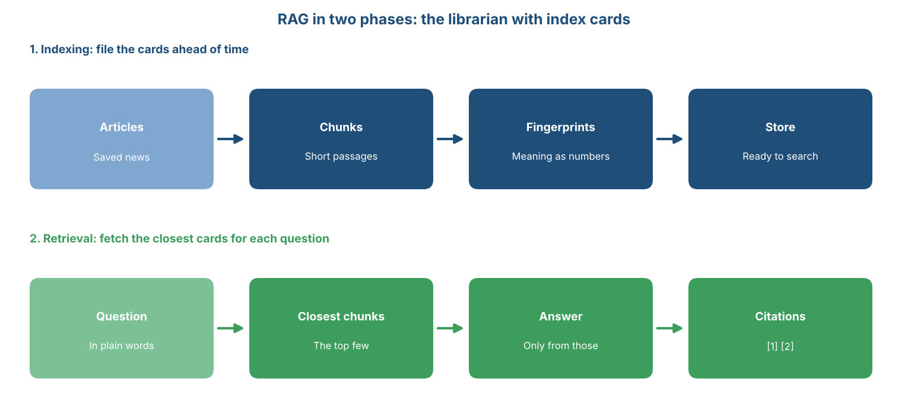
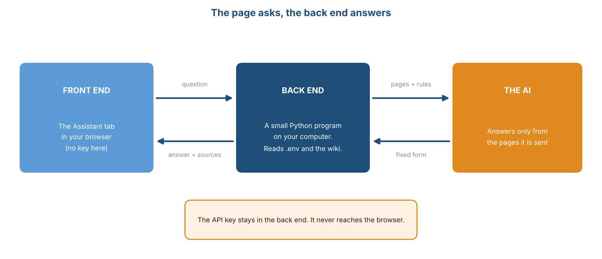

**Learning objectives.** Explain why the AI cannot read every article for every question, build an AI Wiki that turns the saved news into tidy notes, explain RAG at a high level and when to choose it instead, and build the Assistant tab: a chatbot that answers from the notes and shows its sources.

**Big question.** How does the AI answer from hundreds of articles it cannot read all at once?

## 6.1 Why not paste every article?

▶ **Do it:** before reading on, talk with your neighbour for two minutes: why not paste every saved article into every question? Then compare your answers with the table.

| Reason | In plain words |
|----|----|
| **It may not fit** | Hundreds of articles are bigger than the size limit of one call (5.1) |
| **It is slow and costly** | Every token sent is counted, so more text means a bigger bill (1.3) |
| **It loses focus** | With too much text, the AI can miss the point or mix up the banks |

So the AI needs a way to read only what matters. There are two common ways: a student who keeps tidy notes (the **AI Wiki**) and a librarian with index cards (**RAG**). Today you build the first and learn how the second works.

## 6.2 The AI Wiki: a student with tidy notes

A good student does not reread every textbook before an exam. They keep tidy notes, one page per topic, and update them after every lesson. An **AI Wiki** works the same way: the AI reads each article once and keeps a set of notes pages up to date. When someone asks a question, it answers from the notes. The idea comes from Andrej Karpathy's "LLM Wiki" (gist.github.com/karpathy/442a6bf555914893e9891c11519de94f).

| Part | What it is | Who changes it |
|----|----|----|
| `raw/` | The saved articles, one file each | Nobody. The AI reads them and never changes them |
| `AGENTS.md` | The rulebook: how pages are named, what goes in them, how to cite | You |
| `wiki/` | One page per bank, plus `index.md`, which lists every page | The AI writes; you read |

A wiki is kept alive with three jobs:

| Job | What happens | When |
|----|----|----|
| **Ingest** | A new article lands in `raw/`. The AI reads it with the rulebook, updates every page it touches and the index, and notes the change in a log | For each new article |
| **Ask** | The AI reads the index, opens the pages that matter, and answers by naming the pages it used | For each question |
| **Check** | The AI looks for contradictions, old claims and missing links, and fixes them | Now and then |

At our size, the index is enough to find the right page. No special search tools are needed: just folders, files and a rulebook.

## 6.3 Build the wiki

Start with the consultant: reading and proposing change nothing.

▶ **Do it:** still in the **Plan** agent, send:

> **Using that document, propose an AI Wiki for our app.**
>
> Our raw sources are the saved news articles in data/news/ for BBCA, BBRI, BMRI and NISP. Our rulebook is AGENTS.md.
>
> Show the folder layout, the pages you would create and the rules you would add to AGENTS.md. Don't build yet.

**What to look for:** a `raw/` folder, a `wiki/` folder with four bank pages and an index, and rules such as "every claim names its source". If it proposes more than that, push back (2.5): four pages and an index are enough today.

▶ **Do it:** press Tab for the **Build** agent and send:

> **Create the AI Wiki we planned.**
>
> Raw: copy each saved article from data/news/ into raw/ as its own Markdown file, with its title, date, source link and tickers at the top. Keep one copy of an article that appears under more than one bank.
>
> Wiki: a wiki folder with one page each for BBCA, BBRI, BMRI and NISP, and index.md, which lists every page with a one-line summary. Every claim on a page names the raw file it came from.
>
> Rules: add the rules for keeping the wiki to AGENTS.md, including: never edit files in raw/.
>
> Then ingest every article in raw/ and tell me how many pages you wrote.

**What to look for:** (1) `raw/` has one file per article: 70 from the starter archive rather than 80, because articles shared by two banks are kept once; (2) `wiki/BMRI.md` mentions the fall on 16 Oct 2026 and the rebound the week after, and names the raw files it took that from; (3) `index.md` lists the four pages; (4) `AGENTS.md` has the wiki rules. Open one cited raw file: does it say what the page claims?

**Run it: ingest, ask, check.** A wiki earns its keep when new articles arrive. These three articles are invented for practice.

▶ **Do it:** send to **Build**:

> **Add these two invented articles to raw/, dated 9 Nov 2026 and marked at the top as invented practice articles, and ingest both.**
>
> BBRI says branch hours will change next month.
>
> BBRI says branch hours will stay the same next month.

Then, in the same chat, ask the wiki:

> **Did BBRI change its branch hours? Read the index first, open the pages that matter, and answer. Name the pages you used.**

**What to look for:** a good wiki does not quietly pick a side: it says the two articles disagree and names both. If it answers yes or no without mentioning the conflict, run the check job:

> **Check the wiki for contradictions, old claims and missing links. List what you find, then fix it.**

## 6.4 RAG: a librarian with index cards

A librarian does not read every book when you ask a question. Ahead of time, she cuts each book into short passages and files a card for each one. When you ask, she fetches the few closest cards and answers from those. That is **RAG**, short for retrieval-augmented generation.

<Frame caption="Figure 6.1: RAG files the cards ahead of time, then fetches the closest ones for each question.">
  
</Frame>

| Phase | Step | In plain words |
|----|----|----|
| **Indexing (ahead of time)** | Chunk | Cut each article into short passages, called **chunks** |
|  | Embed | Turn each chunk into a meaning fingerprint: a list of numbers that is close for chunks that mean similar things. The fingerprint is called an **embedding** |
|  | Store | Keep the fingerprints ready to search |
| **Retrieval (each question)** | Search | Turn the question into a fingerprint and find the few closest chunks |
|  | Answer | Answer only from those chunks |
|  | Cite | Number the chunks \[1\], \[2\], so every claim points to its source |

Two dials decide whether the right cards come back:

| Dial | The problem | The fix |
|----|----|----|
| **Chunk size** | Too small, and a sentence loses its context. Too big, and one chunk mixes several topics and blurs the match | Try a few sizes, compare the answers, and keep what works |
| **Filters** | Without one, a BBCA article can answer a question about BBRI | Narrow the search first, for example ticker = BBRI and date = Oct 2026 |

You do not need to build RAG today. Knowing how it works tells you when to ask the AI for it.

## 6.5 Wiki or RAG?

|  | AI Wiki | RAG |
|----|----|----|
| **Think of it as** | A student with tidy notes | A librarian with index cards |
| **What it does** | Organises the news into notes ahead of time, and answers from the notes | Leaves the articles as they are, and searches them each time someone asks |
| **Fits when** | The collection is small or medium, and you want a readable summary per bank | The archive is large and growing, and you need the exact source |
| **Watch out for** | A wrong note stays wrong until someone fixes it | The wrong chunks coming back for a question |

One question decides it: do you need the story so far, or the exact article?

## 6.6 Build the Assistant tab

The chatbot needs the AI, and the AI needs the key. A web page cannot hold the key, because anyone can see what a page contains (1.6). So the chatbot gets the app's first real **back end**: a small Python program on your computer. The page sends it the question; the back end reads the wiki, calls the AI and sends back the answer with its sources. The key never leaves the back end.

<Frame caption="Figure 6.2: the front end asks, the back end answers, and the key stays in the back end.">
  
</Frame>

This changes one rule from 2.7, which said the page reads only saved files. Update it first.

▶ **Do it:** press Tab for the **Build** agent, press `ctrl+x` then `n` for a new chat, and send:

> **Update AGENTS.md. Keep everything else.**
>
> Replace the rule that the web page reads only saved files with this one: the web page reads saved files and may send questions to our own local back end. Only the back end reads .env and calls the AI. The API key never reaches the browser.
>
> Add a Sources section: cite only articles saved in this project. The app builds the source list from its own files, never from the model's text.

▶ **Do it:** write the checks first. Send to **Build**:

> **Before building the chatbot, write two checks.**
>
> Check 1. A question the saved news does not cover gets the answer: The saved news does not cover this.
>
> Check 2. Every \[n\] in an answer points to a real file in raw/.
>
> Show me both checks fail first. Don't build yet.

▶ **Do it:** now build it. Send to **Build**:

> **Build the Assistant tab: a chatbot that answers questions about the four banks from the wiki.**
>
> Front end: on the Assistant tab, a question box, a Send button, the answer, and under it a numbered list of sources, each with the article title, date and a link to its raw file. Show the note that the app gives no investment advice.
>
> Back end: a small local Python server. It reads index.md first, opens the pages that matter, and answers only from them. It builds the source list from the raw files those pages cite. Make the call with Pydantic AI, and define the answer as a Pydantic model with the answer text and the list of sources it cites. Set temperature to 0, max_tokens to 500, timeout to 60 seconds and max_retries to 2.
>
> Data: read the wiki and raw/ only. Don't edit them.
>
> Build until both checks pass. Then start the server and tell me the address to open.

**What to look for:** (1) the Assistant tab answers a question, with numbered sources underneath; (2) both checks pass; (3) the key is safe. To confirm it, send "Show me every file the browser loads, and confirm that none of them contains the API key."

▶ **Do it:** ask the chatbot these four questions, one at a time, in the Assistant tab:

| Question | What to look for |
|----|----|
| Why did bank stocks fall in mid October 2026? | MSCI announced a consultation on moving Indonesia from emerging market to standalone market status. The IDX composite index fell more than 15% over two trading days (16 and 19 Oct). BMRI fell 14.8% on 16 Oct, and BBCA hit its lower limit on 19 Oct at Rp 4.820. Every \[n\] opens a real article |
| What is the weather in Jakarta today? | "The saved news does not cover this." |
| What did the news say about NISP on 14 October? | There is no NISP article from that day, and it says so instead of borrowing another day's news |
| What will BBCA announce next month? | It does not predict. At most, it reports what the saved news says about BBCA's plans, with sources |

**Quick check.** Say your answer to your neighbour first, then compare: (1) Why not paste every article into every question? (2) You need the exact article from 14 October. Wiki or RAG?

**Preview:** today we told the AI which data to use. On Day 2 the AI asks for the data it needs, with tools, agents and MCP.
