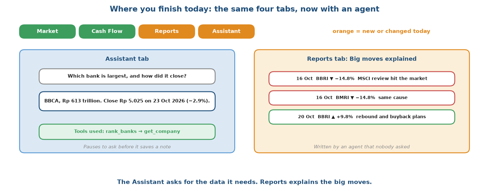
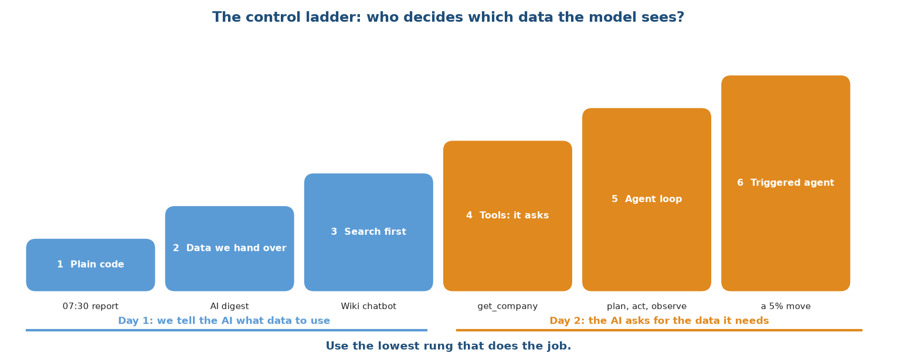

**Learning objectives.** See where Day 2 ends, place Day 1 and Day 2 on the control ladder, and check that the Day 1 app still runs, with the extra setting Day 2 needs.

**Where we left off.** On Day 1 the app got four tabs, a daily report with an AI digest, and a chatbot that answers from the AI Wiki. In every one of those, **we** chose the data the AI saw: our code picked the report, or the question picked the notes. Today the AI starts to ask for the data it needs. Nothing here is investment advice: the stock data is for practice only.

## 0.1 Today’s finish line

Same house, new wiring. By the end of the day the Assistant tab is an **agent**: it chooses its own tools, shows which ones it used, and pauses for your approval before it saves anything. The Reports tab gets a new list, “Big moves explained”, written by an agent that nobody asked.

<Frame caption="Figure 0.1: the finished app. Orange marks what changes today.">
  
</Frame>

## 0.2 From being told to asking

Think of the intern from Day 1 (Day 1, 1.1). On Day 1 you handed the intern a folder and said “answer from this”. Today the intern may open the filing cabinet and pull out the file it needs. You still hold the key to the cabinet, and you decide which drawers exist.

|  | Day 1: the model is told | Day 2: the model asks |
|----|----|----|
| **Who chooses the data** | Our code, or the question through a search | The model, from a list of tools |
| **Works well when** | The questions and their data are known in advance | The data a question needs depends on the question |
| **Cost per answer** | Fixed and low | Grows with the steps the model takes |
| **Predictability** | High | Lower: two runs may take different routes |

Asking is not an upgrade to use everywhere. For a fixed job, such as the 07:30 report, our code knows exactly which data it needs and should fetch it. Tools earn their place when people ask open questions. The **control ladder** shows the six rungs, from plain code up to an agent that starts by itself. Climb only as high as the job needs.

<Frame caption="Figure 0.2: Day 1 covered rungs 1 to 3. Day 2 climbs rungs 4 to 6.">
  
</Frame>

## 0.3 Start: check the project and add one setting

Day 2 keeps the plain HTML page and the local Python back end from Day 1. Only the back end grows. Nothing new is installed, but the Sectors MCP address goes into `.env` for Session 4.

▶ **Do it:** open `.env` in the editor and add one line on its own: `SECTORS_MCP_URL=https://sectors-mcp.supertype.ai/mcp`. Keep the existing keys. No quotes, no spaces around `=`. Never paste a key into the chat.

▶ **Do it:** press Tab for the **Plan** agent, press `ctrl+x` then `n` for a new chat, and send:

> **Read AGENTS.md and list the folders in this project. Tell me in plain words what each one is for and which rules we already have.**
>
> Don't change anything.

**What to look for:** a list that includes `data/`, `reports/`, `prompts/`, `tests/`, `docs/`, `raw/` and `wiki/`, the rules from Day 1 (plain HTML and JavaScript, code computes and the model explains, keys only in `.env`, never buy, sell or hold), and **no files changed**.

▶ **Do it:** start the local back end as on Day 1 (6.6), open the Assistant tab and ask: *Why did bank stocks fall in mid October 2026?*

**What to look for:** an answer about MSCI’s consultation on moving Indonesia from emerging to standalone market status, with numbered sources that open real articles. If it works, today’s starting point is sound.

**Quick check.** Say your answer to your neighbour first, then compare: (1) Who chose the data on Day 1, and who chooses it today? (2) Why is the 07:30 report still plain code? (3) Which rung of the ladder would you use for a question whose answer you already know where to find?
