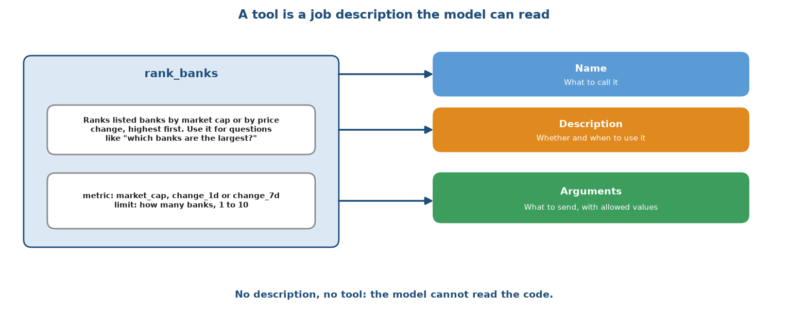
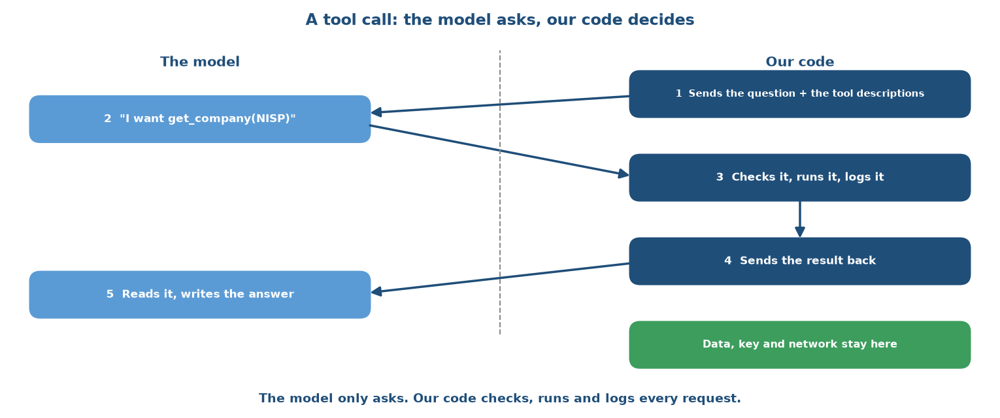
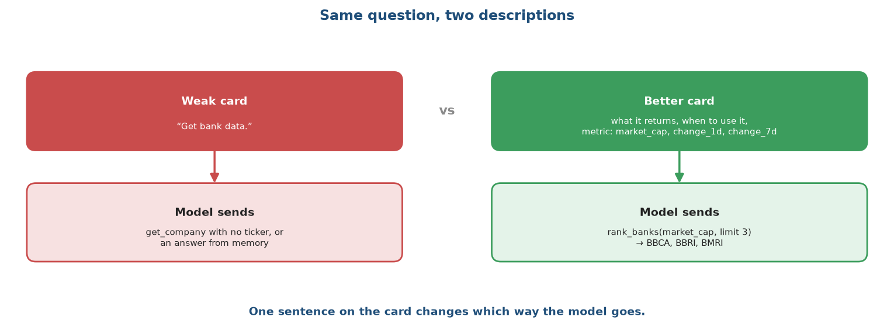

**Learning objectives.** Explain what a tool is, why the model only asks while our code runs it, write descriptions that lead the model to the right tool, choose a small set of read tools, and build three of them with checks written first.

**Big question.** How does the model get data it was never handed, without getting any power it should not have?

## 1.1 What a tool is

A **tool** is an ordinary function plus a description the model can read. Think of the job description you would write for a new colleague: what the job is called, when to call on them, and what to bring. The model never sees the code, only this card.

<Frame caption="Figure 1.1: a tool has three parts the model can read.">
  
</Frame>

| Part | Tells the model | Where it comes from |
|----|----|----|
| **Name** | What to call it | The function’s name |
| **Description** | Whether and when to use it | The plain-words text we write |
| **Arguments** | What to send: names, types, allowed values | The argument list and its defaults |

Giving the model a tool does not give it the power to run it. A tool is a menu card, not a key.

## 1.2 The model asks, our code decides

A **tool call** is a short exchange. Our code sends the question and the descriptions. The model replies with a request, never with a result. Our code decides whether to run it, runs it, and sends the result back for the model to read.

<Frame caption="Figure 1.2: one tool call. The gap between steps 2 and 3 is where all control lives.">
  
</Frame>

Because every request passes through our code, we can check the arguments, refuse a tool, limit how often it runs, write it in the log, or ask a person first (Session 3). The model never touches the data, the key or the network.

## 1.3 The description decides

The model knows nothing about a tool except its name, description and arguments. A vague card leads to the wrong tool, to no tool (the model answers from memory), or to wrong arguments. Allowed values matter most: a model cannot guess the internal name of a field.

<Frame caption="Figure 1.3: the same question with a weak and a better description.">
  
</Frame>

| A good description says | For example |
|----|----|
| **What it returns** | “Ranks listed banks by a metric, highest first.” |
| **When to use it** | “For ranking questions such as ‘Which banks are the largest?’” |
| **What each argument means, with allowed values** | “metric: one of market_cap, change_1d, change_7d” |
| **Formats and units** | “ticker: 4 letters, such as NISP, never NISP.JK” |
| **What it is not for** | “Does not return prices: use get_company for those.” |

When a tool keeps being misused, fix the description before anything else.

## 1.4 Choosing the tools

Every description is sent with every call, so more tools mean a longer, costlier prompt and more look-alikes to confuse. A good set is small and distinct: three to five tools. Keep two kinds apart.

| Kind | Does | Example | Needs approval? |
|----|----|----|----|
| **Read** | Fetches data and changes nothing | Company price, bank ranking, news search | No |
| **Action** | Changes something: a file, an email, a record | Save a note, send an email | Yes (Session 3) |

Three questions help you choose. Which questions must the system answer? Map each to a tool, because a question with no tool is answered from memory. Do two tools overlap? Merge them or sharpen their descriptions. Does any tool act? Then it needs approval, or it stays out. A read-only assistant gets read tools only.

Existing features become tools too. On Day 1 every question triggered a wiki lookup. As a tool, `search_news` runs only when a question needs reasons from the news, the model writes its own search words, and it can combine the result with a price in the same answer.

**Think about it.** Take a question a colleague asks often. Which tools would a model need to answer it, and in which order? Which of them would be actions, and what would go wrong if the model used one at the wrong time?

## 1.5 Build the three read tools

Same loop as Day 1: the consultant interviews you, you write the checks first, the contractor builds. Our three tools are `get_company` (price and change for one bank), `rank_banks` (a ranking) and `search_news` (the AI Wiki and the saved articles). All three read saved files only.

First, two files join the project. Your trainer gives you `data/top_banks_market_cap.json` and `data/top_movers_banks.json`, saved from Sectors on 23 Oct 2026. They write tickers as `BBCA.JK`, which is a chance to apply our rule: *NISP, never NISP.JK*.

▶ **Do it:** press Tab for the **Plan** agent, press `ctrl+x` then `n` for a new chat, and send:

> **Read AGENTS.md. Interview me about three read tools for the Assistant, one question at a time. When I say the brief is complete, write a step-by-step plan.**
>
> Front end: nothing yet.
>
> Back end: three read tools called get_company, rank_banks and search_news, each with a description in plain words. They return only saved data.
>
> Data: the saved price and company files in data/, the two ranking files, and wiki/ with raw/.
>
> For each step, say how we will test it. Don’t build yet.

**What to look for:** one question at a time, then a short plan with a test per step, and **no files changed**. Answer with specifics (Day 1, 2.5): get_company takes a ticker and an optional date; rank_banks takes a metric (market_cap, change_1d or change_7d), an order and a limit.

▶ **Do it:** **test first.** Press Tab for the **Build** agent and send:

> **The plan is approved. Save the brief as docs/brief_tools.md and the plan as docs/plan_tools.md. Then, before building anything, write three checks.**
>
> Check 1. get_company for NISP on 23 Oct 2026 returns a close of 1185 and a change of +0.4%.
>
> Check 2. rank_banks by market cap with a limit of 3 returns BBCA, BBRI and BMRI in that order, written without .JK.
>
> Check 3. get_company for BBXX returns a “no data” message and does not crash.
>
> Show me all three fail. Don’t build yet.

**What to look for:** three checks, all reported as failing, because nothing is built yet.

▶ **Do it:** send to **Build**:

> **Build the three read tools from the approved plan.**
>
> Back end: put them in a tools folder. Each description says what the tool returns, when to use it, the allowed values for each argument and what it is not for. Tickers are always four letters. Tools return data and never change a file.
>
> Data: saved files only. Do not call the internet.
>
> Build until all three checks pass. Then add a Tools section to AGENTS.md: every tool has a description with those five parts, read tools and action tools stay apart, and an action tool always needs approval. Keep everything that is already there. Don’t change anything else.

**What to look for:** (1) all three checks pass; (2) ask Build “Show me each tool’s name, description and arguments in plain words”: you can read all three cards; (3) closes on 23 Oct 2026 from `get_company`: BBCA Rp 5.025 (−2.9%), BBRI Rp 2.910 (+0.3%), BMRI Rp 3.900 (+1.3%), NISP Rp 1.185 (+0.4%); (4) `rank_banks` by market cap: BBCA about Rp 613 trillion, BBRI Rp 437 trillion, BMRI Rp 360 trillion; (5) `search_news` for “BMRI net profit” finds the 23 Oct articles: Rp 45.5 trillion for the first nine months, up 20.7%, with the raw file named.

## 1.6 Try it: the description decides

The tools exist. Now see how much work the card does. First, a tiny script lets the model make **one** choice, with no loop yet.

▶ **Do it:** send to **Build** in a new chat:

> **Write a small script that gives the three tools to the AI model set in .env, using Pydantic AI, and asks: Which three banks are the largest?**
>
> Print the tool the model asks for, the arguments it sends, and its answer. Never print the key. Run it once with the real descriptions, then once with a temporary copy where the description of rank_banks is only “Get bank data.” Delete the copy afterwards.

**What to look for:** with the real card, the model asks for `rank_banks` with metric market_cap and limit 3, and answers BBCA, BBRI, BMRI. With “Get bank data.” it may pick `get_company` with no ticker, send a made-up metric name, or answer from memory. Whichever it does, you fixed it by changing one sentence, not any code.

**Quick check.** Say your answer to your neighbour first, then compare: (1) What does the model see of a tool? (2) Who runs the function, the model or our code? (3) A ranking question was answered from memory. What do you check first?
