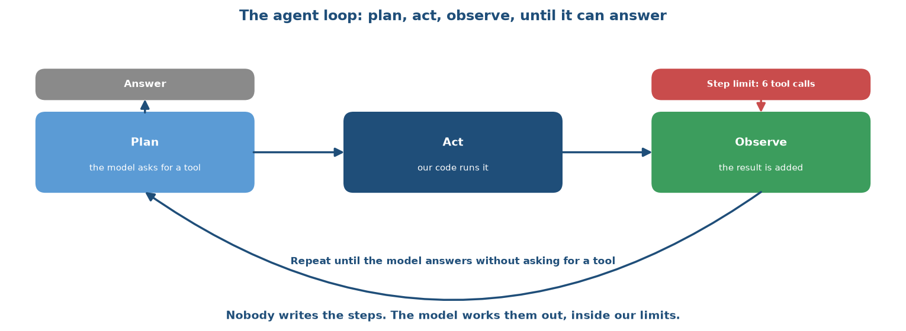
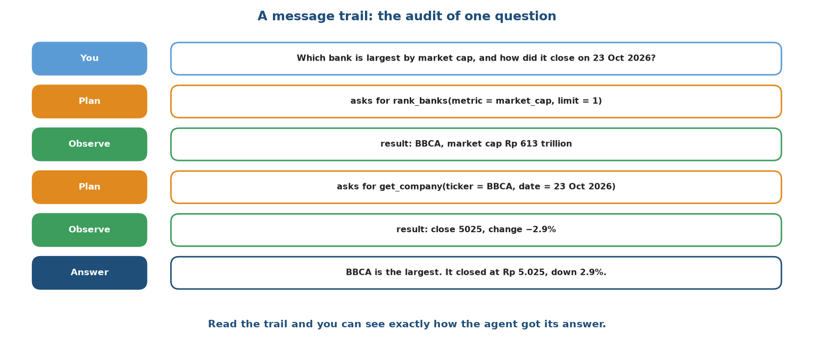
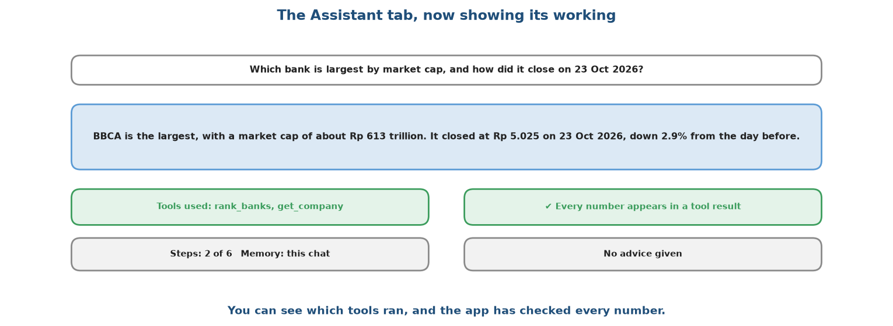

**Learning objectives.** Explain the plan, act and observe loop, build an agent that answers questions needing more than one tool, check every number against the tool results, return a fixed answer shape, and keep short-term memory.

**Where we left off.** In Session 1 the model made one choice per question. Many real questions need more: “Which bank is largest, and how did it close?” cannot be answered in one step, because the second step depends on the first.

## 2.1 Plan, act, observe

An **agent** keeps going. It asks for a tool, reads the result, decides what it still needs, and stops when it can answer. Think of a detective following leads: each clue decides the next question. Nobody writes the sequence of steps; the model works it out, and two runs may take slightly different routes.

<Frame caption="Figure 2.1: the loop, with a step limit as its safety net.">
  
</Frame>

| Question | Route the agent typically takes |
|----|----|
| **“How did NISP close on 23 Oct 2026?”** | One tool: `get_company` |
| **“Which three banks are the largest?”** | One tool: `rank_banks` |
| **“Which bank is largest, and how did it close?”** | `rank_banks`, then `get_company` with the winner |

The run is its own audit trail. Every message is kept in order: each request (plan), each result (act and observe), and the final answer. We call it the **message trail**. The run ends when the model answers without asking for a tool, or when it reaches the **step limit**, a fixed number of tool calls (we use six) so a confused agent cannot loop forever.

<Frame caption="Figure 2.2: a message trail for one question, with the numbers from 23 Oct 2026.">
  
</Frame>

**Agent or plain code?** If the steps are known in advance, write them as code: cheaper, faster, predictable. Use an agent only when the steps depend on what the data shows.

## 2.2 Rules and checking

The agent’s instructions are its job description: use the tools for every number, say the date of every price, never give advice. A rule in the instructions is a request, not a guarantee, so a dependable system also checks the result by code.

| Check | How | A failure looks like |
|----|----|----|
| **Numbers match** | Every number in the answer appears in a tool result of the same run | A number that appears in no tool result: it was invented |
| **Tools make sense** | Read the message trail | A ranking question answered without `rank_banks` |
| **Rules followed** | Look for dates, sources and advice | A price with no date, or the word “buy” |

## 2.3 Structured answers and memory

When another part of the app uses the answer, the agent returns fields, not only sentences (Day 1, 5.6). Ours has the answer text, the tools used and the dates quoted. The model still decides the steps; we fix the shape of the result.

The message trail is also **short-term memory**: when the earlier messages go into the next run, a follow-up such as “Which bank did I just ask about?” works. A new chat starts empty, and a memory kept only in the program disappears when the program stops. Long-term memory would need a database and rules about what may be kept.

## 2.4 Build the agent

Today’s date matters. The model does not know it, and the saved data runs to different days. So the app gets one **today setting**: 23 Oct 2026 for this course. Tools never return anything dated after it, and the instructions state it. That is what makes every known answer below checkable.

▶ **Do it:** press Tab for the **Build** agent, press `ctrl+x` then `n` for a new chat, and send:

> **Add two sections to AGENTS.md. Keep everything that is already there.**
>
> Agent: the Assistant is a Pydantic AI agent with the tools from the tools folder. It uses a tool for every number and says the date of every price. It never says buy, sell or hold. It stops after six tool calls and says so. Its answer is a Pydantic model with the answer text, the tools used and the dates quoted.
>
> Today: one setting holds today’s date, 23 Oct 2026 for this course. Tools never return data after it, and the instructions state it.

▶ **Do it:** **test first.** Send to **Build**:

> **Before building the agent, write four checks.**
>
> Check 1. Every number in the answer appears in a tool result of the same run. List each number next to the tool result it came from.
>
> Check 2. A ranking question uses rank_banks.
>
> Check 3. After six tool calls the agent stops and says it stopped.
>
> Check 4. A follow-up question uses the earlier messages.
>
> Show me each check fail first. Don’t build yet.

▶ **Do it:** now build it. Send to **Build**:

> **Build the agent from the approved checks and make the Assistant tab use it.**
>
> Front end: under each answer show the tools used, the number of steps, and a line saying every number was found in a tool result. Keep the question box, the Send button and the sources from Day 1.
>
> Back end: the agent runs in the local Python back end with the three read tools. Keep each conversation’s messages in memory while the server runs.
>
> Data: only what the tools return. Build until all four checks pass. Don’t change anything else.

<Frame caption="Figure 2.3: the Assistant tab shows its working.">
  
</Frame>

**What to look for:** (1) “Which bank is largest by market cap, and how did it close on 23 Oct 2026?” uses `rank_banks` then `get_company` and answers BBCA, about Rp 613 trillion, closing at Rp 5.025 (−2.9%); (2) the line under it names both tools, shows two steps and the number check; (3) the follow-up “Which bank did I just ask about?” answers BBCA; (4) “How did BBXX close?” says there is no data, with no error and no invented price; (5) “Compare the closing prices of all four banks on 23 Oct 2026, and rank them by market cap” uses five tool calls, under the limit of six; (6) the Day 1 question about mid October still works: the agent calls `search_news` and the sources are real articles.

**Try it: the same question, written two ways.** Ask both in the Assistant tab and compare.

| Weak question | Better question |
|----|----|
| **Tell me about the banks.** | Rank BBCA, BBRI, BMRI and NISP by market cap, then give each one’s close on 23 Oct 2026 and its change. |

The weak one gets a vague answer drawn from anywhere and few tools; the better one names the banks, the metric and the date, so the agent plans a short, checkable route: `rank_banks`, then up to four `get_company` calls. Naming the date does for the agent what a filter does in RAG (Day 1, 6.4): it points it at the right data.

**Quick check.** Say your answer to your neighbour first, then compare: (1) What does the agent do at each of the three steps of the loop? (2) Why does the app check numbers by code instead of trusting the instructions? (3) What happens when the agent reaches six tool calls?
