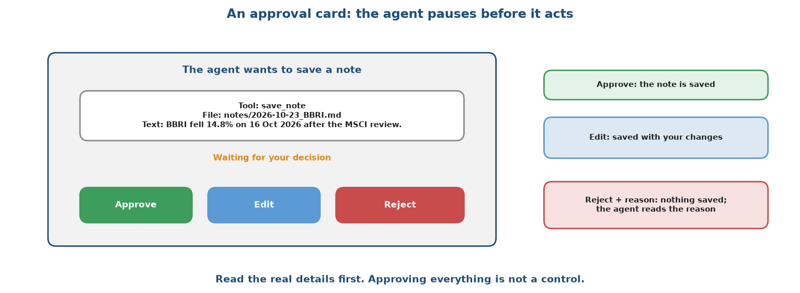
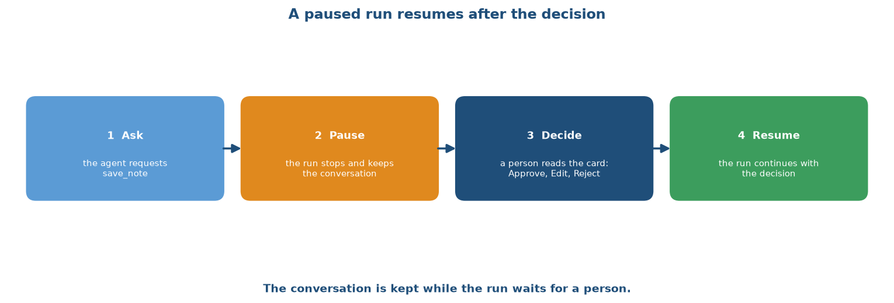

**Learning objectives.** Explain why actions need a person’s approval, build a “save a note” action that pauses for Approve, Edit or Reject, add a ready-made tool the safe way, and pick only the tools the job needs.

**Big question.** An agent that only reads cannot do harm. What changes the moment it can write?

## 3.1 Reading is safe, acting is not

Reading data changes nothing. Writing a file or sending an email does, and an email cannot be unsent. So action tools pause. **Approval** (a person in the loop) means the agent stops before the action, shows exactly what it wants to do, and carries on only after a person decides. Think of a cashier who may never release a payment without the manager’s signature on the slip.

<Frame caption="Figure 3.1: the three decisions on an approval card.">
  
</Frame>

| Decision | Effect |
|----|----|
| **Approve** | The action runs as proposed |
| **Edit** | The action runs with your changes, such as a corrected file name or text |
| **Reject, with a reason** | The action does not run; the agent reads the reason and carries on |

## 3.2 How approval works

Two things make it work. The list of tools that pause is explicit (here `save_note`), so reading and searching run without interruption. And a paused run comes back as a list of requests waiting for a decision, together with the conversation so far, so it can resume after the decision. Approval helps only when the reviewer sees the real details and has time to read them. A habit of approving everything is not a control.

<Frame caption="Figure 3.2: ask, pause, decide, resume.">
  
</Frame>

## 3.3 Build the “save a note” action

`save_note` writes a short Markdown note to a `notes/` folder. It is the first action tool, so it is also the first test of our rules from Session 1.

▶ **Do it:** press Tab for the **Build** agent, press `ctrl+x` then `n` for a new chat, and send:

> **Before building, write three checks for a save_note action tool.**
>
> Check 1. Nothing is saved before a person approves.
>
> Check 2. If the person rejects with a reason, no file is saved and the agent’s reply mentions the reason.
>
> Check 3. If the person edits the text, the edited text is saved.
>
> Show me all three fail. Don’t build yet.

▶ **Do it:** send to **Build**:

> **Build the save_note action and its approval card.**
>
> Front end: when the agent wants to save a note, the Assistant tab shows a card with the file name and the full text, and three buttons: Approve, Edit and Reject. Reject has a box for a reason.
>
> Back end: save_note is the only tool that pauses. Reading and searching tools run without asking. The paused run resumes with the person’s decision.
>
> Data: notes are saved in a notes folder, named with the date and the ticker, for example 2026-10-16_BBRI.md. Add an Actions rule to AGENTS.md: an action tool always pauses for approval, and the list of pausing tools is explicit. Keep everything that is already there. Build until all three checks pass. Don’t change anything else.

**What to look for:** ask “Save a note on why BBRI fell on 16 Oct 2026.” (1) The agent reads first, using `get_company` for 16 Oct (close Rp 2.640, −14.8%, after Rp 3.100) and `search_news`; (2) the card appears with the file name `notes/2026-10-16_BBRI.md` and the full text, and the `notes/` folder is still empty; (3) **Reject** with the reason “too long”: no file, and the agent mentions the reason; (4) ask again and **Edit** one sentence, then **Approve**: the file holds your edit; (5) every number in the note appears in a tool result.

## 3.4 Ready-made tools and other services

Not every tool has to be written by hand. Pydantic AI offers ready-made tools for common services, and any service with an API can be wrapped as a tool of our own. To the agent they look the same: a name, a description and arguments.

| Tool | Kind | Our use |
|----|----|----|
| **Web search** | Read | Used for news only, with the source named. Numbers still come from our own tools |
| **Email draft** | Harmless: it only writes a draft | Optional below. Sending is not switched on in class |
| **Email send** | Action | Trainer-led demo only, with approval on every send |

Three principles apply to every outside service. **Pick, don’t take everything:** an email toolkit can also search and read a mailbox; an agent that only drafts gets only that one tool, so it has fewer wrong choices and no access it does not need. **Any API can become a tool:** wrap it with a clear description and return something the model can use. **Outside information has its own rules:** web results are not verified data, so use them for news, name the source, and keep numbers coming from the trusted tools.

▶ **Do it:** send to **Build**:

> **Add a web search tool to the agent, for news only.**
>
> Back end: it is a read tool, so no approval. Its description says it is for news and background, never for prices or rankings. The agent must name the source and the date of anything it takes from the web.
>
> Data: nothing is saved. Add the rule to AGENTS.md. Keep everything that is already there. Don’t change anything else.

**What to look for:** ask “What is the latest news on BBRI’s buyback?”: the agent searches, names the source site and date, and says the web is not verified. Ask “What is BBRI’s price?”: it uses `get_company`, not the web, and every number still comes from a tool. If your provider does not offer web search, your trainer shows this on screen instead.

▶ **Do it:** optional: send to **Build**:

> **Add a draft_email tool that only writes a draft: a recipient, a subject and the text, saved as a Markdown file in a drafts folder. It cannot send anything.**
>
> Test first: show me a check that the tool has no way to send. Don’t change anything else.

**What to look for:** a draft file for a question such as “Draft an email to the finance team about BBRI’s move on 16 Oct 2026”, with the real numbers (Rp 3.100 to Rp 2.640, −14.8%) and nothing sent. Sending stays a trainer-led demo, because it needs mail credentials and approval on every send.

**Quick check.** Say your answer to your neighbour first, then compare: (1) Which tools pause, and who decides which ones? (2) Why is a note saved only after the card, not before? (3) The agent drafts an email. Which of the three principles applies?
