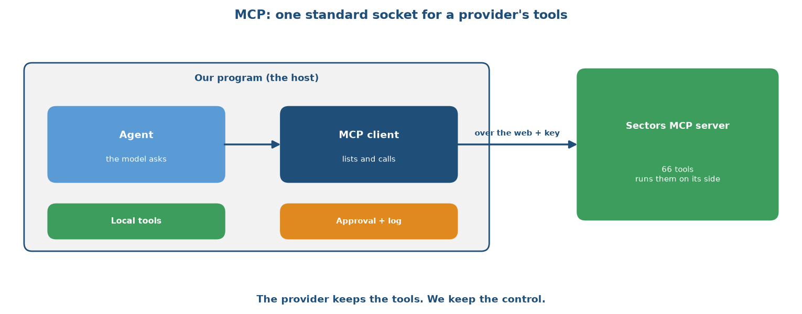
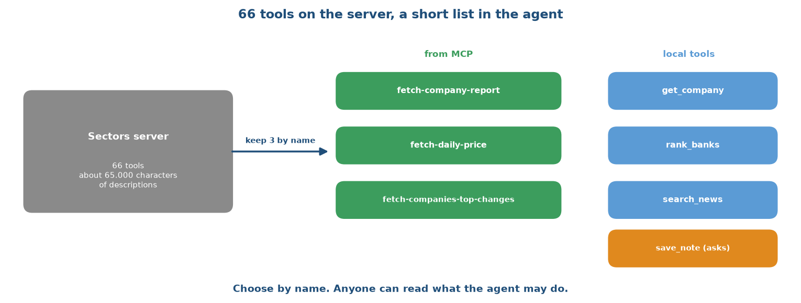

**Learning objectives.** Explain what MCP is and what problem it solves, name host, client and server, connect OpenCode and then the app’s agent to the Sectors MCP server, keep only the tools the job needs, mix them with local tools, and decide whether to trust a server.

**Where we left off.** Every data tool so far was a function **we** wrote and look after. That does not scale: a provider may have dozens of endpoints, and a bank may have many AI applications that need the same tools.

## 4.1 The problem MCP solves

Think of the power socket in your wall. Any plug that fits the standard works in any socket, and nobody rewires the house for each appliance. The **Model Context Protocol (MCP)** is such a socket for tools: a provider runs one server and publishes its tools once, and any MCP client can find them and call them the same way.

| Without MCP | With MCP |
|----|----|
| **We write and maintain a tool for every endpoint** | The provider maintains the tools on its server |
| **A new endpoint means new code in every app** | A new tool simply appears in the server’s list |
| **Each app keeps its own copy of the descriptions** | One description, written by people who know the data |
| **Tools are hard to share across teams** | Any MCP client (our agent, an AI assistant, an IDE) can connect |

MCP is worth it when a provider already runs a server with tools you need, when several apps should share the same tools, or when the data owner is best placed to look after them. For one or two endpoints you want to control closely, a local tool is simpler. Real systems use both. We use the server Sectors already runs; we do not build one.

## 4.2 Host, client and server

<Frame caption="Figure 4.1: our program is the host and the client. Sectors runs the server.">
  
</Frame>

| Role | In this course | Does what |
|----|----|----|
| **Host** | Our Python back end | Runs the agent and owns the conversation |
| **Client** | A part inside our back end | Opens the connection, lists the tools, sends the calls |
| **Server** | Run by Sectors | Offers the tools and runs them on its side |
| **Model** | The AI model from `.env` | Reads the descriptions and requests calls |

The client is our code, not the model. The model never connects to the server and never sees the key. It requests an MCP tool exactly as it requested a local one, and our code passes the request on, so everything from Session 1 still holds: every call passes through us. A server can offer **tools** (functions to call, used here), resources (data to read) and prompts (templates). It is reached over the web with the key sent in a header, or as a local program.

## 4.3 Connect OpenCode first

OpenCode is an MCP client too. Connecting it first shows what the server offers before our agent depends on it. The steps are in Appendix A.

▶ **Do it:** press Tab for the **Build** agent, press `ctrl+x` then `n` for a new chat, and send:

> **Add the Sectors MCP server to OpenCode, following Appendix A of the coursebook.**
>
> Use the address in SECTORS_MCP_URL and the key in SECTORS_API_KEY. Never write the key into any file. Then tell me how to restart OpenCode.

▶ **Do it:** restart OpenCode, open a new chat in the **Plan** agent and send:

> **Using the Sectors tools, tell me how many tools the server offers, and give me NISP’s daily closing prices from 14 to 23 October 2026.**
>
> Don’t change any file.

**What to look for:** the server offers **66 tools**; NISP has **8 trading days** in that range, from Rp 1.225 on 14 Oct to Rp 1.185 on 23 Oct, with Rp 1.120 on 16 Oct (−8.6%) and Rp 1.145 on 20 Oct. These are saved Sectors prices, so they do not move.

## 4.4 Connect the app’s agent, with a short list

The server offers 66 tools, and their descriptions alone run to about 65.000 characters. Passing all of them would send that text with every model call: slow, costly, and full of look-alikes. The rule from Session 1 applies more strongly: choose the few tools the job needs. We keep three, **by name**, in an explicit list that anyone can read: `fetch-company-report`, `fetch-daily-price` and `fetch-companies-top-changes`.

Three practical points help you understand it, without memorising it. The connection has a lifetime: it is opened, used and closed. MCP calls wait for the server without freezing the page. And the server’s tools use their own argument names and need explicit dates, which is why the agent’s instructions state today’s date (Session 2).

<Frame caption="Figure 4.2: the short list: three MCP tools plus our local tools.">
  
</Frame>

▶ **Do it:** **test first.** Send to **Build**:

> **Before connecting, write three checks.**
>
> Check 1. The agent sees exactly three Sectors tools, by name, plus our local tools.
>
> Check 2. Asking for a Sectors tool that is not on the list, such as fetch-brokers, gets “I don’t have a tool for that”.
>
> Check 3. The key appears in no log line and in no file the browser loads.
>
> Show me all three fail. Don’t build yet.

▶ **Do it:** send to **Build**:

> **Connect the agent to the Sectors MCP server and keep three of its tools.**
>
> Front end: in the tools-used line, mark each tool as local or MCP.
>
> Back end: the agent’s back end acts as the MCP client, using the address in SECTORS_MCP_URL and the key in SECTORS_API_KEY. Keep only fetch-company-report, fetch-daily-price and fetch-companies-top-changes, by name. Keep every local tool, and keep approval on save_note.
>
> Data: nothing new is saved. Build until all three checks pass. Don’t change anything else.

**What to look for:** (1) “How did NISP trade between 14 and 23 October 2026?” uses `fetch-daily-price` and the answer matches 4.3: 8 days, Rp 1.185 on 23 Oct; (2) “Which bank stocks gained most over the last 7 days?” uses `fetch-companies-top-changes`. That data is live, so the names can differ from the saved sample (BSWD +43.6%, BBNI +15.2%, BMRI +15.0% on 23 Oct 2026). Check the tool and that every number is in its result; (3) a mixed request, “Find the top 7-day gainer among banks, then save a note about it”, uses an MCP tool and then pauses on the **same** approval card; (4) the three checks pass.

## 4.5 Mixing tools, and trusting a server

The agent sees one list of tools; where each runs does not matter to the model. A rule of thumb: use MCP for the provider’s data, and keep local tools for what only you have: your saved news, your own notes, actions in your own systems. Approval works the same for both, because every call passes through our agent.

Connecting to a server means trusting it. Treat it like a skill (Day 1, Appendix A): read before you trust.

| Question | Why it matters |
|----|----|
| **Who runs the server, and is it approved?** | Its tools run on someone else’s systems |
| **What does the key allow?** | The key gives the server’s access, not only the tools you selected |
| **Which tools are actions?** | Server tools that change something need approval like any other |
| **Can the descriptions change?** | A changed description changes the agent’s behaviour without a code change |

**Quick check.** Say your answer to your neighbour first, then compare: (1) Why does the agent get three of the 66 tools? (2) Who holds the key, the model or our back end? (3) When would you write a local tool instead of using MCP?
