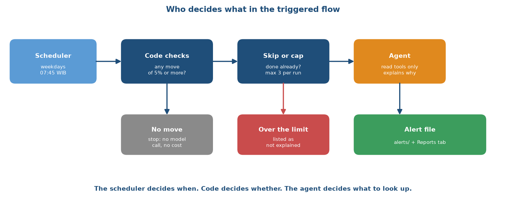
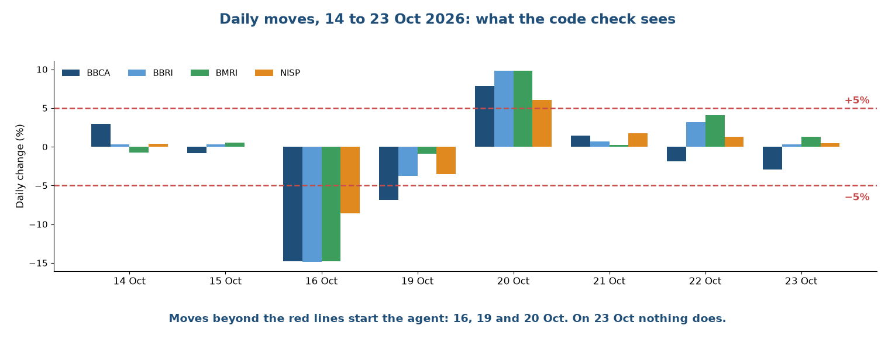

**Learning objectives.** Say who decides what in a triggered flow, build a job where a 5% move starts an agent that explains it from prices and news, and apply the safeguards that replace the person who is no longer there: a code condition, skip what is done, a cooldown, a run limit, read tools only and failure isolation.

**Where we left off.** On Day 1 the scheduler ran fixed code at fixed times. Today the agent decides what to look up, but only when a person asks. Now we join them: a schedule starts a check, and only a real event wakes the agent. This is the top rung of the ladder.

## 5.1 Who decides what

Picture a smoke alarm on a clock. The clock decides when to check, the sensor decides whether there is smoke, and only then does the fire crew decide what to do about it. You would not ask the crew to check every room every hour.

<Frame caption="Figure 5.1: the triggered flow, with an exit for every safeguard.">
  
</Frame>

| Part | Decides | In our app |
|----|----|----|
| **Scheduler** | When to check | Weekdays at 07:45 WIB, after the 07:30 report |
| **Code** | Whether something happened | Did any bank move 5% or more in a day? |
| **Agent** | What data explains it | Looks up the prices and the saved news |
| **Code** | Where the result goes | A file in `alerts/`, shown on the Reports tab |

Why is the condition code, not the agent? “Did a bank move 5% or more?” has a definite answer. Code gives it free, in milliseconds, the same way every time. The model is called only when there is something to explain, so cost follows events, not the clock. **Code decides whether to act; the model explains.** Do not confuse the scheduler with the agent: the scheduler decides *when* fixed code runs, the agent decides *what data to get next*.

<Frame caption="Figure 5.2: the daily moves the code check sees. Everything beyond a red line starts the agent.">
  
</Frame>

## 5.2 Safe triggers

An automated agent has nobody watching each run, so the safeguards move into the design.

| Safeguard | Why | Our setting |
|----|----|----|
| **The condition is code** | Deterministic, free and testable | A move of 5% or more in a day |
| **Skip what is done** | The same move is never explained twice (idempotent, Day 1, 4.2) | One alert per date and ticker |
| **Cooldown** | A bank explained yesterday is not explained again today | Skip a ticker explained on the previous trading day |
| **A limit per run** | A market-wide crash cannot start hundreds of runs | 3 explanations; the rest are listed as not explained |
| **Read tools only** | A triggered agent never acts; actions stay with people | No `save_note`; anything sent needs approval |
| **Step limit** | A confused agent cannot loop | 6 tool calls per explanation |
| **Failure isolation** | If the agent fails, the alert still goes out | The alert says the explanation is missing |

A cooldown can also hide a real new event, so every setting is a trade-off you write down in advance. Automation does not remove judgement: it moves it from the moment of running to the moment of designing.

## 5.3 Build the triggered agent

▶ **Do it:** press Tab for the **Build** agent, press `ctrl+x` then `n` for a new chat, and send:

> **Add a section to AGENTS.md. Keep everything that is already there.**
>
> Triggered agents: code decides whether to start the agent. The agent has read tools only. Limits per run: 3 explanations and 6 tool calls each. A ticker explained on the previous trading day is skipped. A move already explained is never explained twice. If the agent fails, the alert is still saved and says the explanation is missing. Every run writes one line to the run log.

▶ **Do it:** **test first.** Send to **Build**:

> **Write five checks for the triggered agent, using the prices for 16 and 23 Oct 2026.**
>
> Check 1. On 23 Oct 2026 no bank moved 5% or more: no agent call is made and the log says so.
>
> Check 2. On 16 Oct 2026 four banks moved 5% or more: three are explained, and the fourth is listed as not explained, with the reason “run limit”.
>
> Check 3. Running 16 Oct twice saves no new alert the second time.
>
> Check 4. If the agent fails for one bank, its alert is still saved and says the explanation is missing.
>
> Check 5. The triggered agent has no action tools.
>
> Show me each check fail first. Don’t build yet.

▶ **Do it:** now build it. Send to **Build**:

> **Build the triggered agent from the approved checks.**
>
> Front end: on the Reports tab, add a list called Big moves explained: for each alert the date, the bank, the move in percent, a short explanation and its sources.
>
> Back end: add a job to the scheduler that runs every weekday at 07:45 in the Asia/Jakarta time zone. Code works out each bank’s daily change from the saved prices. A move of 5% or more starts the agent with read tools only, biggest move first. Let me give a date so we can replay a day.
>
> Data: one file per date and ticker in an alerts folder, for example alerts/2026-10-16_BBRI.md, holding the numbers that triggered it, the explanation and its sources. One line in the run log for every run. Build until all five checks pass. Don’t change anything else.

▶ **Do it:** replay four days in order. Send to **Build**:

> **Run the check for 16, 19, 20 and 23 Oct 2026, in that order. Then show me the alerts folder and the run log.**

**What to look for:** (1) **16 Oct:** BBRI −14.8% (Rp 3.100 to Rp 2.640), BMRI −14.8% (Rp 3.980 to Rp 3.390) and BBCA −14.8% (Rp 6.075 to Rp 5.175) are explained; NISP −8.6% (Rp 1.225 to Rp 1.120) is listed as not explained, “run limit”; (2) **19 Oct:** BBCA −6.9% (Rp 5.175 to Rp 4.820) is skipped by the cooldown, because it was explained the trading day before; (3) **20 Oct:** BBRI +9.8%, BMRI +9.8% and BBCA +7.9% are explained; NISP +6.0% (Rp 1.080 to Rp 1.145) is not explained; (4) **23 Oct:** no move, no agent call; (5) six alert files and four log lines. The 16 Oct explanations name the MSCI consultation on moving Indonesia to standalone market status. They are written after the fact, from articles dated 20 to 25 Oct, and say so. No number is invented and nothing says buy, sell or hold.

▶ **Do it:** **try it:** see the trade-offs. Send to **Build**:

> **Temporarily set the cooldown to 0 and replay 19 Oct 2026. Then set the run limit to 4 and replay 16 Oct 2026. Show me the new alerts, then put both settings back.**

**What to look for:** with no cooldown, BBCA on 19 Oct is now explained (it hit its lower limit at Rp 4.820). With a limit of 4, NISP is explained on 16 Oct: the saved NISP news stops on 12 Oct, so the alert must not claim a NISP-specific cause. If it mentions the market-wide fall, it says it is market-wide.

**Quick check.** Say your answer to your neighbour first, then compare: (1) Who decides whether the agent runs, and why? (2) Why does a triggered agent get read tools only? (3) A crash moves all four banks at once. Which safeguard stops 400 model calls?
