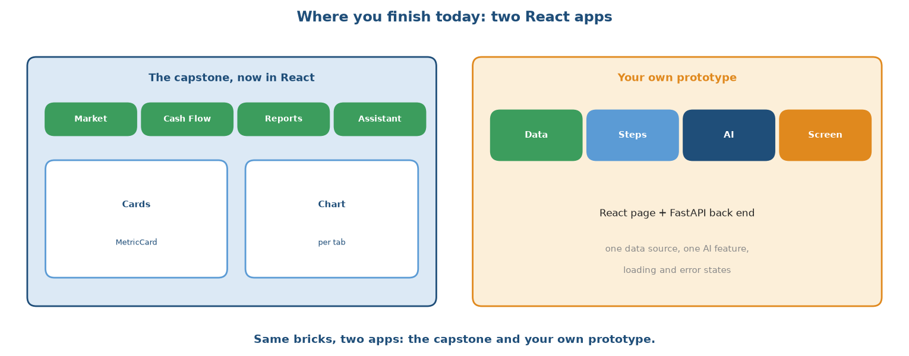
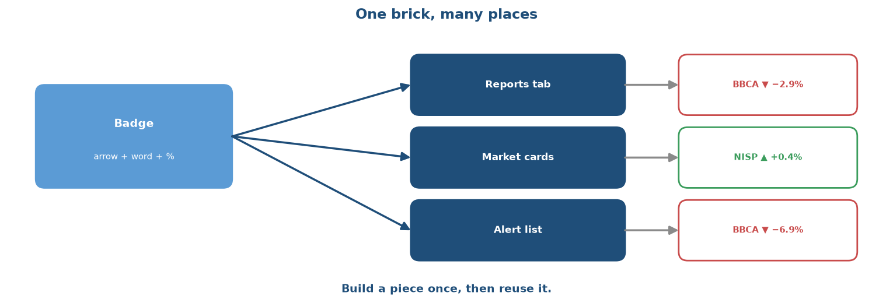

**Learning objectives.** See where Day 3 ends, say why one plain page reaches its limits, and get your laptop ready for React. By the end of the day the capstone runs as a React app, and so does a prototype of your own.

**Where we left off.** On Day 2 the Assistant became an agent: it asks for the data it needs, shows the tools it used, pauses for approval before it saves a note, and lists the 5% moves the scheduler found. All of that lives on one plain HTML, CSS and JavaScript page, with a Python back end behind it. Today the app gets a real interface, built from React components. Nothing here is investment advice: the stock data is for practice only.

## 0.1 Today's finish line

Two apps are running by 16:00. The first is the capstone, with the same four tabs and the same numbers, now drawn by React. The second is your own idea: one data source, one AI feature and a screen, started from the same structure.

<Frame caption="Figure 0.1: the capstone in React, and your own prototype beside it.">
  
</Frame>

## 0.2 Why one plain page is reaching its limits

Think of a LEGO set. Without bricks you glue every model from scratch, and a change to one wall means touching the whole model. With bricks you build a piece once, snap it in wherever it is needed, and swap it when it breaks. That is the idea behind React, a library for building a page out of reusable pieces called **components**.

Our page has outgrown a single file. Four tabs, up/down badges, a chat, approval cards and an alert list all have to stay in step with data that keeps changing. The same badge appears in two places, and every fix has to be made twice.

<Frame caption="Figure 0.2: the Badge is built once and used on three screens.">
  
</Frame>

|  | One plain page (Days 1 and 2) | React components (Day 3) |
|----|----|----|
| **A repeated piece** | Copied where it is needed; fixes made twice | One component, used everywhere |
| **Changing data** | Code redraws each part by hand | You describe the page; React redraws when the data changes |
| **Growing the page** | One long file that is hard to check | One small file per piece, checked on its own |
| **What you still do** | Describe, check | Describe, check. You still never write the code |

## 0.3 Get your laptop ready

React needs two extra tools on your laptop: **Node.js**, which runs JavaScript outside the browser, and **npm**, its package installer (like pip for Python). Appendix A has the details. Let OpenCode check them for you.

▶ **Do it:** press `Tab` for the **Build** agent, press `ctrl+x` then `n` for a new chat, and send:

> **Check that Node.js and npm are installed on this laptop. Show me both version numbers.**
>
> Front end: nothing yet.
>
> Back end: nothing yet.
>
> Data: nothing yet.
>
> Don't install or change anything.

**What to look for:** (1) Node.js prints a version number, and so does npm; (2) no file in the project changed. If either is missing, tell your trainer now. A laptop on the office network may also need the proxy settings in Appendix A.

▶ **Do it:** open the Day 2 app and click through the four tabs, so you know what must survive the move: Market, Cash Flow, Reports and Assistant. Ask the Assistant one question and look at the tools it used.

**Quick check.** Say your answer to your neighbour first, then compare: (1) Why is a Badge a good component? (2) What does React redraw when data changes? (3) Which tools must be on your laptop before the next session?
