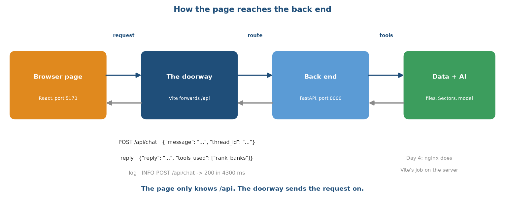

**Learning objectives.** Compare the interface options and say when each one fits, recall what HTML, CSS and JavaScript do and why the behaviour is handed to React, follow one request from the page to the back end and back, read one back-end log line, and tell which layer an error lives in.

**Big question.** When a colleague types a question on the page, what happens before the answer appears?

## 1.1 Interface options

Until now you have used the agent through a chat in OpenCode or on one test page. A relationship manager will not do that. An **interface** is the place where people meet the system, and there are three common kinds.

| Option | What it is | Fits when | In our app |
|----|----|----|----|
| **Web page** | A page opened in a browser | People ask and explore | The four tabs |
| **Chatbot** | A web page where the input is a conversation | Questions vary every time | The Assistant tab |
| **Alert, email or file** | A job that starts on a timer or a condition and needs no input page | People should read, not ask | The 07:30 report and the 5% move alerts |

A scheduled job has no page where the user types. Its interface is its output, the place where the result arrives. The agent behind it is the same: only the way it starts and the way its result reaches the user change. The course builds a web page for three reasons: nothing to install, one version for everyone, and any device with a browser can use it. An installed app is a fourth kind, and we do not build one.

## 1.2 What a page is made of, and why we hand over the behaviour

You met the three languages in Day 1, 2.2: **HTML** is the skeleton, **CSS** the paint and furniture, **JavaScript** the wiring and the light switches. HTML and CSS can be learned in a day or two. Behaviour is harder: keeping every part of the page in step with changing data takes a great deal of knowledge. So we hand that job to React, and OpenCode writes the code around it. You read the result on screen and test it.

A browser asks a server for a page. The server sends back HTML, CSS and JavaScript, and the browser runs them. The page then sends more requests, such as a question for the agent. The messages are written in **JSON**, a tidy text format (Day 1, 3.1). The browser runs JavaScript. It does not run Python, so it cannot reach your agent directly.

## 1.3 The doorway: /api

Your Python agent is the **back end**. The page needs an address to send a question to, and a program at that address that runs the agent and sends back the answer. Think of a reception desk: visitors never walk into the offices, they ask at the desk. The desk is a **route**, one address in an **API** (such as `/api/chat`) that is connected to one function. **FastAPI** is the Python library that connects addresses to functions, and **uvicorn** is the program that listens on a **port** and passes each request to FastAPI.

<Frame caption="Figure 1.1: the page asks at /api; the doorway sends the request on.">
  
</Frame>

Two ports are in play. The page runs on port 5173 and the back end on port 8000. A browser blocks a page from calling a different address without that server's permission (a rule called **CORS**). The page avoids the problem by calling `/api` on its own address, and Vite, the tool that serves the page while you work, **forwards** anything that starts with `/api` to port 8000. On Day 4, nginx does the same job on the server.

| Status code | Meaning | What the page should show |
|----|----|----|
| **200** | The back end answered | The reply and the tools used |
| **400** | The request was empty or wrong | The back end's own short message |
| **422** | The request had the wrong shape, for example a number where text belongs | Rarely seen: the page sends the right shape. You meet it on the /docs test page |
| **500** | The back end or a tool failed | A short error message; the details are in the log |
| **502** | The doorway cannot reach the back end | "Server error (502)": the back end is not running |

The page sends the question and a **thread id**, a name for the conversation. The back end keeps the conversation history under that name, so a follow-up such as "And the fourth?" works. Two things are lost at different moments. FastAPI runs a plain function in a separate worker, so one slow question does not freeze the others.

| Data | Lives in | Lost when |
|----|----|----|
| **The chat bubbles** | The browser's memory | The page is refreshed |
| **The agent's conversation history** | The back end's process | The back end restarts |

To test the back end without the page, FastAPI builds a test page at `/docs` that lists every route and lets you press **Try it out**. You will use it in 2.0.

## 1.4 Reading a log line, and which layer failed

A **log** is a text file where a program writes what it did. The back end will write one line for every request. Learn to read it now, because Day 4 relies on it.

`2026-10-29 09:14:02,311 INFO POST /api/chat -> 200 in 4300 ms`

| Part of the line | Meaning |
|----|----|
| **2026-10-29 09:14:02,311 INFO** | The time, and how serious the message is (INFO is a normal event) |
| **POST /api/chat** | The request the page sent: POST sends data, GET fetches it |
| **-\> 200** | The status code from the table above |
| **in 4300 ms** | How long the request took, in milliseconds |

When the page shows an error, ask which layer it lives in. The error appears on the page, but it is rarely caused there.

| Symptom | Layer | Where to look |
|----|----|----|
| **A tool returns a wrong number** | Data | Open the saved file, or run the tool on a known input |
| **The page shows Server error (500)** | Back end | The back end's log, and the ERROR line under it |
| **The page shows Server error (502)** | Doorway | The back end is not running: open /api/health |
| **The page is blank or does not react** | Front end | The browser console, opened with F12 |

## 1.5 Try it: follow one request

▶ **Do it:** press `Tab` until the **Plan** agent is active, press `ctrl+x` then `n` for a new chat, and send:

> **Explain in plain words what happens when I type a question on the Assistant tab, from my click to the answer.**
>
> Front end: which page file sends the question, and to which address.
>
> Back end: which program receives it, which tools it may call, and where the key is kept.
>
> Data: which saved files or services supply the numbers.
>
> Don't change anything. Don't show code.

**What to look for:** (1) a short story with five or six steps, in plain words; (2) the back end is a small local Python server from Day 1, 6.6, and the key stays there; (3) no file changed. Compare the story with Figure 1.1. Today you will replace the small server with a FastAPI app and move the page to React.

**Quick check.** Say your answer to your neighbour first, then compare: (1) Which interface fits a morning report that nobody asks for? (2) The page shows Server error (502). Which layer do you check first? (3) What does the number before "ms" in a log line tell you?
