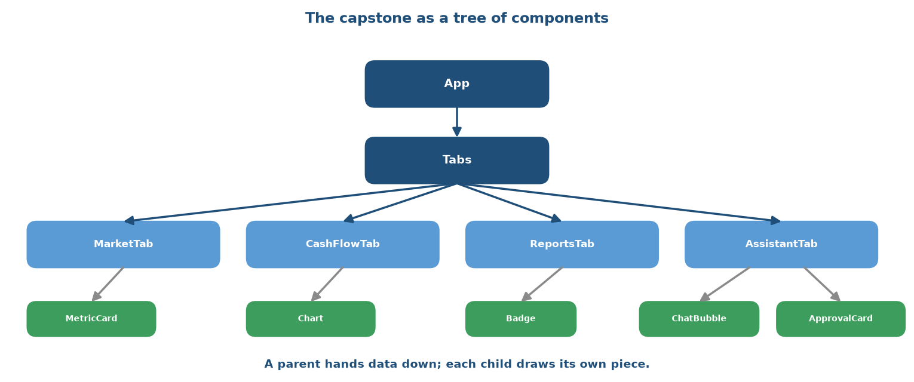
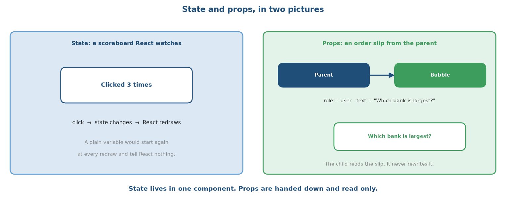

**Learning objectives.** Move the back end to FastAPI, explain component, state, props and loading and error states in plain words, ask the Plan agent to map the current page into components, and move the Market tab to React with a test first.

**Where we left off.** You know how a request travels. Now the page itself changes: the same four tabs and the same data, built from components. The Python back end and every saved file stay as they are.

## 2.0 Start: the back end becomes a FastAPI app

React runs next to the back end, so the back end must be ready first. It becomes a FastAPI app run by uvicorn on port 8000. This replaces the small local server from Day 1, 6.6. Every route keeps its job: the same answers, the same tools, the same key rules.

▶ **Do it:** press `Tab` for the **Build** agent, press `ctrl+x` then `n` for a new chat, and send:

> **Turn the local back end into a FastAPI app that uvicorn runs on port 8000.**
>
> Front end: nothing yet. The old page keeps working through the same addresses.
>
> Back end: keep every route and tool we already have, under the address /api, for example /api/chat. Add /api/health, which answers status ok. Write one log line for every request to logs/app.log, in this form: time, level, method, path, status code and milliseconds, for example: POST /api/chat -\> 200 in 4300 ms. Never log a key.
>
> Data: read the same saved files. Change no file in data/, raw/, wiki/ or reports/.
>
> Then start the back end and tell me the address of the test page. Do not touch the page.

**What to look for:** (1) the address /api/health answers with status ok; (2) the test page at /docs lists the routes; (3) press **Try it out** on the chat route, send "Which three banks are largest by market cap?": the answer names BBCA, BBRI and BMRI, in that order, and the tools used line shows `rank_banks`; (4) `logs/app.log` has a new line that ends with a status code and milliseconds, and no line contains a key. A tool that writes `BBCA.JK` breaks the rule: tickers are BBCA, never BBCA.JK.

## 2.1 Component, state, props: three ideas, in pictures

React builds the page from **components**: a component is a piece of the page with its own logic and its own look. It can be as small as a button or as large as a whole tab. The capstone has one at every size.

<Frame caption="Figure 2.1: the capstone as a tree: App at the top, one component per piece below.">
  
</Frame>

**State** is a value that React watches. Picture a scoreboard: when the number changes, the board redraws. A plain variable cannot do this job. React draws the component again whenever anything changes, so an ordinary variable starts from scratch each time, and changing it tells React nothing. State fixes both problems. **Props** are the other half. A parent hands data to a child like an order slip, and the child reads it by name. The slip is read only: a component never rewrites its own props, and anything that must change goes into state.

<Frame caption="Figure 2.2: the Counter button is state; the Bubble is a child that reads props.">
  
</Frame>

The old coursebook used two tiny examples. A **Counter** button keeps a count in state and shows "Clicked 3 times"; every click changes the number and the button redraws. A **Bubble** takes a role (user or assistant) and a text from its parent and draws one chat message. You will never read their code. You will recognise the ideas when OpenCode names them in its summaries.

**Loading and error states.** React describes the page for each situation and lets the state decide which description shows. The chat page has three.

| Situation | State that says so | What the page shows |
|----|----|----|
| **Waiting for the back end** | loading is true | A "Thinking" bubble, and the Send button is disabled |
| **The agent answered** | loading is false, a new message in the list | The reply as a new bubble, with the tools used |
| **The back end failed** | loading is false, an error message in the list | A short error bubble, never a blank page |

Keep state small. If one value can be worked out from another, such as an empty box from the length of the text, do not store it twice: two copies can disagree. The words below will appear in OpenCode's summaries. You need to know what each one is for, not how it is written.

| You will hear | In plain words |
|----|----|
| **JSX** | HTML-like layout written inside the JavaScript |
| **The four blocks of App.jsx** | Settings (title, example questions), state (what React watches), functions (what happens on a click), layout (what the page shows) |
| **A list and a key** | The chat is a list of messages. Each bubble gets a key, an id that does not change, so React can update the right one |
| **useEffect, async and await** | Small helpers that scroll the chat down and wait for the back end without freezing the page |

## 2.2 Plan: map the page into components, and update the rulebook

Ask the consultant first. It reads the page and proposes the pieces, and nothing is built.

▶ **Do it:** press `Tab` for the **Plan** agent, press `ctrl+x` then `n` for a new chat, and send:

> **Read AGENTS.md and the current page. Propose how to rebuild the page in React with Vite, one tab at a time.**
>
> Front end: draw the tree of components, from App down to the smallest pieces. Name the state each component owns and the props it receives.
>
> Back end: no change. The page talks to it only through /api.
>
> Data: no change.
>
> Don't build yet.

**What to look for:** (1) a tree close to Figure 2.1: App, Tabs, MarketTab, CashFlowTab, ReportsTab, AssistantTab, and small pieces such as MetricCard, Badge, ChatBubble and ApprovalCard; (2) each tab owns its own loading and error state; (3) no file changed. If it invents more than the tree needs, push back: one tab first.

The Day 1 rulebook still says the page is plain HTML, CSS and JavaScript. Update it now, so every fresh chat knows the new rule.

▶ **Do it:** press `Tab` for the **Build** agent and send:

> **Update AGENTS.md. Keep every rule that is already there, except the two sentences that say the page is plain HTML, CSS and JavaScript.**
>
> Replace "Plain HTML, CSS and JavaScript only." with: The front end is React with Vite in `frontend/`: one component per file in `src/components/`, state kept in the component that owns it, and the page talks to the back end only through `/api`.
>
> Also replace "the screen is plain HTML, CSS and JavaScript" with "the screen is React". Keep "Do not add extra features I did not ask for."
>
> Add: the back end is a FastAPI app that uvicorn runs on port 8000, and Vite forwards /api to it.
>
> Change no other file.

**What to look for:** `AGENTS.md` has the new front-end rule word for word, still holds your Day 1 and Day 2 rules, and no other file changed.

## 2.3 Implement: the Vite project and the Market tab

**Test first.** Before anything is built, write the checks in plain words: (1) the Market tab shows NISP's last close of Rp 1.185 and BBCA's of Rp 5.025 for 23 Oct 2026; (2) with the back end switched off, the tab shows a clear error message and not a blank page.

▶ **Do it:** press `Tab` for the **Build** agent, press `ctrl+x` then `n` for a new chat, and send:

> **Create the React page in frontend/ with Vite, and move the Market tab first. Before you build, write the two checks below as test files and show me they fail.**
>
> Check 1. With the saved data, the Market tab shows NISP at Rp 1.185 and BBCA at Rp 5.025 (23 Oct 2026). Check 2. If the back end does not answer, the tab shows an error message.
>
> Front end: a Vite project in frontend/ with src/App.jsx, src/App.css and one file per component in src/components/. The tab bar and the Market tab only: a ticker dropdown, three metric cards in one MetricCard component, and the state-owned banks table with BMRI and BBRI marked. Show a loading state and an error state. The other three tabs say "Coming soon".
>
> Back end: add the routes the Market tab needs under /api. Make Vite forward /api to port 8000. Change no existing route.
>
> Data: read only the saved files, through the back end. Build until both checks pass. Then run the page and tell me the address. Do not touch the old page.

**What to look for:** (1) the address is `http://localhost:5173` after `npm run dev`; (2) NISP shows **Rp 1.185** (+0.4%) and BBCA **Rp 5.025** (−2.9%) for 23 Oct 2026; BBRI Rp 2.910 (+0.3%) and BMRI Rp 3.900 (+1.3%); (3) the table marks BMRI and BBRI and not BBCA or NISP; (4) stop the back end and reload: the tab shows a short error, not a blank page, and the back end log has no new line; (5) both checks pass. Behind the scenes OpenCode started two programs. Leave both terminal windows open.

▶ **Do it:** ask the question every manager should ask. Send to **Build** in the same chat:

> **Show me every assumption you made while moving the Market tab.**
>
> Front end: list the choices you made about layout, wording and states.
>
> Back end: list any route or file you added or changed.
>
> Data: list any number you rounded or formatted. Don't change anything.

**What to look for:** a list of decisions you did not make, such as how a percentage is rounded or what the error message says. Pick one you disagree with and tell Build to change it.

**Quick check.** Say your answer to your neighbour first, then compare: (1) Which component owns the list of chat messages? (2) A Badge needs the word "down" and a percentage. How do they reach it? (3) What should the Market tab show when the back end is off?
