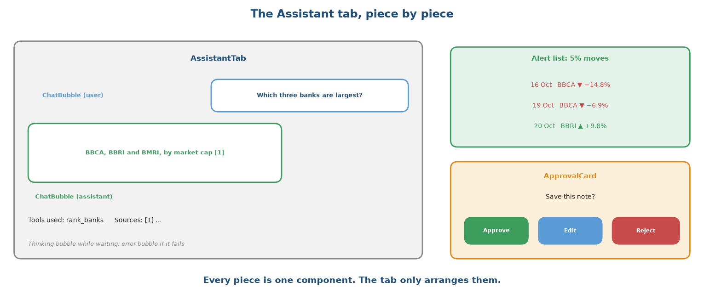

**Learning objectives.** Move Cash Flow, Reports and Assistant to React, one tab per prompt, and check each against its Day 1 and Day 2 known answers; reuse one Badge component; describe changes to OpenCode in five good habits; and polish the page with the `frontend-design` skill.

**Where we left off.** The Market tab runs in React. Three tabs say "Coming soon". Each move follows the loop from Day 1, 2.4: say the check first, build one tab, test it against the number you already know.

## 3.0 Start: one tab, one prompt

A move is safe only when it is small. Every prompt below names one tab, keeps the back end and the saved files as they are, and ends with "Don't change anything else". If a check fails, tell Build which check failed and what you saw.

## 3.1 The Cash Flow tab

▶ **Do it:** press `Tab` for the **Build** agent, press `ctrl+x` then `n` for a new chat, and send:

> **Move the Cash Flow tab to React. Write the check first and show me it fails.**
>
> Check. The total net cash flow shown above the chart is Rp 1.330.000.000.
>
> Front end: a CashFlowTab component with the total above a chart: monthly net cash flow as bars and the ending balance as a line. Labelled axes, thousands separators, a loading state and an error state.
>
> Back end: add a route under /api that returns the rows of data/cash_flow_sample.csv.
>
> Data: read only data/cash_flow_sample.csv. Don't change anything else.

**What to look for:** (1) 12 months, Nov 2025 to Oct 2026; (2) the total is **Rp 1.330.000.000**, the same as your hand-added total from Day 1, 3.3; (3) two bars point down: Jan 2026 (−Rp 30.000.000) and Apr 2026 (−Rp 60.000.000); (4) the line ends at **Rp 3.330.000.000** in Oct 2026; (5) the check passes.

## 3.2 The Reports tab and one Badge

▶ **Do it:** send to **Build**:

> **Move the Reports tab to React, with one reusable Badge component.**
>
> Front end: ReportsTab shows the newest report, the next run time in Jakarta time and the AI digest. Each bank gets a Badge: an arrow, the word up, down or flat, and the change in percent. Use the same Badge component everywhere a trend appears.
>
> Back end: add routes under /api for the newest report and the next run time. The percentage comes from the report, never from the AI.
>
> Data: read only the files in reports/. Don't change anything else.

**What to look for:** for the report of 23 Oct 2026: (1) the badges read **BBCA ▼ down −2.9%**, **BBRI ▲ up +0.3%**, **BMRI ▲ up +1.3%** and **NISP ▲ up +0.4%**; (2) the digest has three to five sentences and no buy, sell or hold; (3) the next run is a weekday at 07:30 WIB; (4) there is one Badge file in `src/components/`, not four copies.

## 3.3 The Assistant tab

This tab holds the most pieces, because Day 2 added so much to it.

<Frame caption="Figure 3.1: the Assistant tab is one tab and several components.">
  
</Frame>

▶ **Do it:** send to **Build**:

> **Move the Assistant tab to React, with everything Day 2 added.**
>
> Front end: AssistantTab keeps a list of messages in state. Components: ChatBubble for each message, a line under each answer that names the tools used, a numbered source list, and an ApprovalCard that shows Approve, Edit and Reject with a reason when the agent wants to save a note. Show the alert list of 5% moves from alerts/. A Thinking bubble while waiting, and a short error bubble if the back end fails. Keep the note that the app gives no investment advice.
>
> Back end: no change to the agent or its tools. The page sends the question and a thread_id under /api, so follow-up questions work.
>
> Data: read only through the back end. Don't change anything else.

**What to look for:** (1) "Which three banks are largest by market cap?" names BBCA, BBRI and BMRI and shows `rank_banks` as the tool used; (2) a follow-up such as "And the fourth?" works, because the thread id is sent; (3) the alert list shows 9 moves of 5% or more: four on 16 Oct 2026 (BBCA, BBRI, BMRI −14.8%, NISP −8.6%), BBCA −6.9% on 19 Oct and four on 20 Oct (BBCA +7.9%, BBRI and BMRI +9.8%, NISP +6.0%), none for 23 Oct; (4) asking it to save a note shows an approval card and nothing is saved until you press Approve; (5) with the back end off, the tab shows an error bubble.

## 3.4 Describe changes like a good teammate

After the move you will tweak the page many times. Five habits keep the loop short. Where to look: `src/App.jsx` shows the tab bar, `src/App.css` holds colours and spacing, and `src/components/` holds one file per piece.

| Habit | Example |
|----|----|
| **Name the file** | "In src/components/Badge.jsx, ..." |
| **Say what you see and what you expect** | "The Send button stays grey after I type. It should turn navy." |
| **One change per prompt** | One button, or one colour, or one layout change |
| **Paste the error text** | Copy it from the back end terminal or the browser console (F12) |
| **Leave the plumbing alone** | Do not ask for changes to index.html, main.jsx, vite.config.js or the back end routes unless that is the point |

| Goal | A good prompt |
|----|----|
| **Add a button** | "In src/components/AssistantTab.jsx, add a Clear button that empties the conversation." |
| **Change the look** | "In src/App.css, change the accent colour to dark blue." |
| **Change the layout** | "In src/App.css, make the chat bubbles narrower on a phone." |
| **Add a shortcut list** | "Add a side list with BBCA, BBRI, BMRI and NISP. A click asks the Assistant for that bank's overview." |
| **Add a tool** | "In the back end, add a tool that returns a bank's dividend yield, and update the agent rules in AGENTS.md." |

## 3.5 Polish with a skill, then break it on purpose

▶ **Do it:** with the **frontend-design** skill from Day 1, Appendix A, send to **Build**:

> **Use the frontend-design skill to make the page look more polished: spacing, colour and the look of the cards and badges.**
>
> Front end: change only src/App.css and the look of the components. Keep the layout and the words.
>
> Back end: no change.
>
> Data: no change. Don't change what any component does.

**What to look for:** the page looks tidier and every number from 3.1 to 3.3 is still the same. If a number moved, undo with `ctrl+x` then `u`.

▶ **Do it:** **break it on purpose.** Stop the back end, reload the page and open each tab. Then start it again.

**What to look for:** every tab shows its own short error message and none is blank; after the restart, the numbers come back. A blank tab is missing an error state.

▶ **Do it:** **the same request, written two ways.** Send each to **Build**, then compare, and undo the weak one with `ctrl+x` then `u`:

| Weak prompt | Better prompt |
|----|----|
| **Make the Reports tab better.** | In src/components/Badge.jsx, make the arrow and the word the same colour: green for up, red for down, grey for flat. Change nothing else. |

**What to look for:** the weak prompt changes things you did not ask for, perhaps the layout or the wording; the better one changes one file and one thing.

**Quick check.** Say your answer to your neighbour first, then compare: (1) Which components use the Badge? (2) Why is "make it nicer" a weak prompt? (3) The page total and your hand total differ. Which one do you check first?
