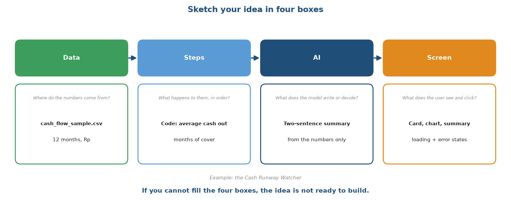

**Learning objectives.** Pick an idea that fits a finance team, sketch it in four boxes, place it on the collect, connect, act map, choose the lowest rung of the control ladder that works, sketch the screen as components, let the AI interview you, and start a new React and FastAPI project with its own `AGENTS.md`.

**Big question.** What is the smallest useful system you can finish by 16:00?

## 4.1 Pick an idea

Choose something a finance colleague would use every week. It must be small: one data source, one AI feature and one screen. Public data and made-up company data only (Day 1, 1.6).

| Idea | Data | The AI part |
|----|----|----|
| **Cash runway watcher** | `cash_flow_sample.csv`: 12 months | Two-sentence summary of the cash position |
| **Weekly bank scorecard** | Saved prices for BBCA, BBRI, BMRI, NISP | A short comparison of the four banks |
| **News briefing by bank** | The AI Wiki and `raw/` | Answers a question and cites sources |
| **Big mover explainer** | Prices plus saved news | An agent explains a move of 5% or more |
| **Your own idea** | A public source or made-up company data you can name | Something that needs words, not arithmetic |

Say your idea in one sentence that names who asks what and why it matters. Compare the two versions below, then write yours and read it to your neighbour.

| Weak | Better |
|----|----|
| **A finance dashboard with AI.** | A finance manager checks in ten seconds how many months of cash the company has left, and gets two plain sentences about it. |
| **A chatbot for bank news.** | A relationship manager asks why a bank fell on 16 Oct 2026 and gets an answer with numbered sources. |

## 4.2 Four boxes, then the map and the ladder

Before you ask OpenCode for anything, sketch the idea on paper in four boxes: **Data**, **Steps**, **AI** and **Screen**. If you cannot fill all four, the idea is not ready.

<Frame caption="Figure 4.1: the four boxes, filled in for the Cash Runway Watcher.">
  
</Frame>

Then place the idea on the map from Day 1, 1.5, and check it against the guardrails from Day 1, 1.6.

| Stage | Question for your idea | Example: Cash Runway Watcher |
|----|----|----|
| **Collect** | Which data, from where? | The cash flow CSV, 12 months |
| **Connect** | How does it reach the AI? | Code works out the numbers; the model gets them in tags |
| **Act** | What happens with the answer? | A summary card on screen. Nothing is sent or changed |
| **Guardrails** | Keys, public data, no advice, human approval for actions? | Key only in `.env`; no advice; no action tool |

Now pick the **lowest rung of the control ladder** that works. A lower rung is cheaper, faster and easier to check.

| Rung | Who decides which data the model sees | Use it when |
|----|----|----|
| **Told, fixed code** | Our code, on a schedule | The job and its data never change |
| **Told, grounded call** | Our code puts the facts in the prompt (Day 1, 5.4) | The data is known before the question |
| **Told, wiki or RAG** | A search finds the facts first (Day 1, 6.2 and 6.4) | There are too many articles to paste |
| **Asks, agent with tools** | The model asks for what it needs (Day 2) | The data depends on the question |

The Cash Runway Watcher needs only a grounded call. The numbers are known and few, so code computes them and the model explains (Day 1, 5.3).

## 4.3 Sketch the screen, then let the AI interview you

Draw the screen as boxes. Each box becomes one file in `src/components/`.

▶ **Do it:** press `Tab` for the **Plan** agent, press `ctrl+x` then `n` for a new chat, and send. Replace the idea with yours:

> **Interview me about this system, one question at a time: a Cash Runway Watcher for a company finance team. When I say the brief is complete, write a step-by-step plan.**
>
> Front end: a React page with the screen I sketched. Name the components, and for each one its loading and error state.
>
> Back end: a FastAPI app that serves the data and the AI summary under /api.
>
> Data: the source I chose. For each step in the plan, say how we will test it.
>
> Don't build yet.

**What to look for:** one question at a time, covering all three parts, then a short plan with a test for each step and no files changed. Good answers have numbers: "the summary has two sentences and every number appears in the data".

**What a good brief holds.** The interview ends with a short written brief. Read it like a manager: it should answer the five questions below in a few lines each, and anything missing is a guess the AI will make for you.

| Question | Example answer |
|----|----|
| **Who uses it, and for what?** | A finance manager, to see months of cash cover |
| **What must it show?** | Ending balance, average cash out, months of cover, the two negative months |
| **Where does the data come from?** | The cash flow CSV only; nothing is sent anywhere |
| **What must it never do?** | Give advice, show a number that is not in the data, expose a key |
| **How will we know it works?** | Months of cover is about 4.1 for the sample file |

## 4.4 Start the project

The prototype gets its own folder with its own rulebook, so that your capstone stays safe.

▶ **Do it:** press `Tab` for the **Build** agent and send:

> **The brief is complete. Save it as docs/brief.md and the plan as docs/plan.md. Then create a new project folder called prototype next to the capstone.**
>
> Front end: an empty React and Vite project in prototype/frontend, with the same four-folder layout as the capstone and a page that says the name of my idea.
>
> Back end: an empty FastAPI app in prototype/backend with /api/health, run by uvicorn. Vite forwards /api to it.
>
> Data: nothing yet. Write prototype/AGENTS.md: React with Vite, one component per file, state in the component that owns it, the page talks to the back end only through /api, the key only in .env, no advice, code computes and the model explains, write the check first. Don't change the capstone.

**What to look for:** (1) `docs/brief.md`, `docs/plan.md` and `prototype/AGENTS.md` exist; (2) `/api/health` answers for the prototype; (3) the page shows your idea's name; (4) the capstone folder is unchanged.

**Quick check.** Say your answer to your neighbour first, then compare: (1) Which rung of the ladder fits a summary of 12 known numbers? (2) Why does the model not work out the average cash out? (3) Which box of your sketch becomes a file in src/components/?
