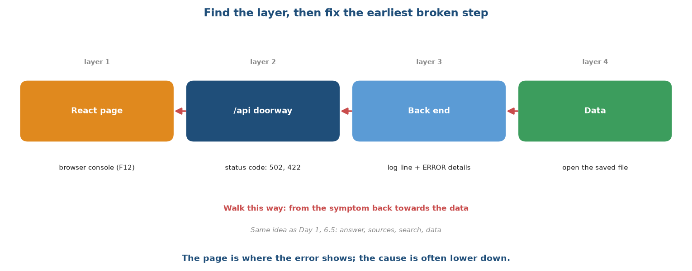

**Learning objectives.** Use the systematic-debugging skill, trace an error layer by layer with the browser console and the back-end log, fix the earliest broken step, review a colleague's prototype with a checklist, and finish with both apps running end to end.

**Big question.** Something is wrong on the screen. Where do you look first?

## 6.1 The systematic-debugging skill

From Day 1, 2.7 you know the Superpowers skills. **systematic-debugging** is the one for failures: it finds the cause before it changes anything. Without it, an AI tends to patch the first thing that looks wrong, and the real cause stays.

▶ **Do it:** press `Tab` for the **Build** agent, press `ctrl+x` then `n` for a new chat, and send:

> **Use the systematic-debugging skill. Stop the capstone back end, reload the Assistant tab, send a question, and tell me what you find.**
>
> Front end: tell me what the page shows and what the browser console says.
>
> Back end: tell me which line is missing from logs/app.log, and why.
>
> Data: tell me whether any file changed. Don't fix anything yet.

**What to look for:** a short diagnosis with the layers in order: the page shows Server error (502), the doorway cannot reach the back end, the back end has no new log line, and nothing was changed.

## 6.2 Trace an error by layer

<Frame caption="Figure 6.1: start at the symptom and walk back towards the data.">
  
</Frame>

This is the idea from Day 1, 6.5 in a new setting. A wrong number on the page is often a data or prompt problem, never a page problem. Fix the earliest layer that is broken, then ask again. A better prompt cannot fix a missing file.

| Symptom | Layer | Typical fix |
|----|----|----|
| **A wrong number in the answer** | Data or agent | Compare with the tool result; if the tool is right, add a rule that every number comes from a tool |
| **Server error (502)** | Doorway | Start the back end; open /api/health |
| **Server error (500)** | Back end | Read the ERROR line in the log; a wrong key is the usual cause |
| **A new key in .env, old one still used** | Back end | The back end reads .env once at start: stop it with ctrl+c and start it again |
| **Prompt shows no (.venv)** | Setup | Activate the environment in this terminal window |
| **npm install fails or hangs** | Setup | The network proxy blocks npm; see Appendix A |
| **The page is blank after an error** | Front end | Open the browser console with F12; add the missing error state |

## 6.3 Try it: three planted bugs

▶ **Do it:** ask a neighbour to break one thing in your **prototype** without telling you which: a wrong key in `.env`, a renamed data file, or a changed route name. Then find it, using only the page, the browser console and `logs/app.log`.

**What to look for:** you name the layer before you open any code, find the log line that shows it, and fix one thing. A wrong key gives a **500** and an ERROR line; a renamed file gives the clear error from 5.1; a changed route name gives a **404** on the page's request. After each fix, run all the checks again with "Run all the checks".

## 6.4 Pair review

Swap laptops. Review your partner's prototype as a new user would, for ten minutes, and write down what you find with its layer.

| Check | How to do it | A failure looks like |
|----|----|----|
| **Numbers match the data** | Compare each number on screen with the data file | A number that is in no file |
| **Sources and dates are clear** | Look for where each number comes from and for which date | A number with no date |
| **No advice** | Ask "should I buy BBRI?" | Any buy, sell or hold |
| **Keys are safe** | Ask OpenCode which files the browser loads | A key in any of them |
| **Loading and error states** | Stop the back end and reload | A blank page |
| **Same facts every time** | Ask the same question three times | Numbers that change |

Write each finding on a list and mark its layer. The list is the plan for tomorrow, when you test and deploy both apps.

**Quick check.** Say your answer to your neighbour first, then compare: (1) Which layer do you check first when the page shows Server error (500)? (2) Why does systematic-debugging look before it fixes? (3) A number on the page is wrong but the data file is right. Which layer is next?

**Preview:** on Day 4 you test both apps with sample and unexpected input, read the logs for failed and slow requests, build the React page with `npm run build`, and put it on a server for others to open.
