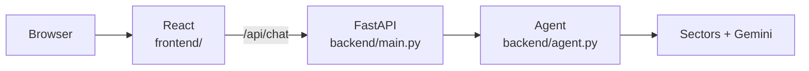

A working chat interface for the Day 2 agent. Run it first, then change it with Copilot.

The starter is in `day3/starter/`.

## How a question travels

## What you edit

| You edit this | To change |
|---|---|
| `frontend/src/App.jsx` | what the page shows and does (title, example questions, layout) |
| `frontend/src/App.css` | colours and styling |
| `backend/agent.py` | the tools and the system prompt (the agent layer) |

You rarely need to open `backend/main.py` (the connecting layer) or `vite.config.js`.

## The day in three steps

<Columns cols={3}>
  <Card title="Read the code" icon="code" href="/day3/read-the-code">
    The blocks of each file, and the rule that ties them together.
  </Card>
  <Card title="Set up and run" icon="terminal" href="/day3/setup-and-run">
    One-time setup, then the backend and the interface in two terminals.
  </Card>
  <Card title="Change it with Copilot" icon="wand-magic-sparkles" href="/day3/copilot">
    Prompts to try, and what to do when something breaks.
  </Card>
</Columns>
