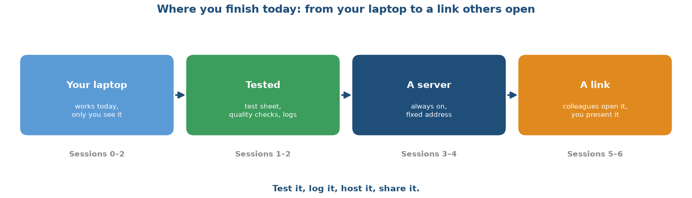

**Learning objectives.** See where the day ends, check that the Day 3 app and your own prototype run, and agree how to work on a real server: OpenCode does the steps, you read each one and check the result.

**Where we left off.** On Day 3 the app got a real interface: a React page in `frontend/` that talks to the Python back end through `/api`. It runs on your laptop, so only you can open it, and it stops when the laptop sleeps. Today it becomes a system others can use. Nothing in this course is investment advice: the stock data is for practice only.

## 0.1 Today's finish line

Think of a restaurant before opening night. The cooking works in your own kitchen, but the doors are still locked. First you test the menu on awkward customers, then you keep a record of what happens, then you move to a shop with a fixed address, and only then do you invite guests. Today follows the same order: **test**, **log**, **host**, **share**. By the end of the day a colleague can open a link and use the app, and you can present it in five minutes.

<Frame caption="Figure 0.1: the four steps of Day 4. The first two make the system trustworthy; the last two put it in front of people.">
  
</Frame>

## 0.2 Check where you start

Both programs of Day 3 must run before you test anything: the Python back end on port 8000 and the React page on port 5173. You also need the login details of your own server from your trainer. They stay in your own terminal and in `.env`; they never go into the chat.

▶ **Do it:** open OpenCode in your project folder, press Tab for the **Build** agent, press `ctrl+x` then `n` for a new chat, and send:

> **Start the back end and the React page, and tell me the two addresses to open.**
>
> Front end: the page runs with the Vite dev server.
>
> Back end: the FastAPI back end runs with uvicorn on port 8000.
>
> Data: change nothing. Never print any key.
>
> Don't change any file.

**What to look for:** (1) the page opens at `http://localhost:5173` with four tabs; (2) in the Assistant tab, the question "How did NISP close on 23 Oct 2026?" gives **Rp 1.185**, up 0.4% from Rp 1.180, with the tool used shown under the answer; (3) no file changed. If a tab is broken, the cause is on Day 3, not today.
