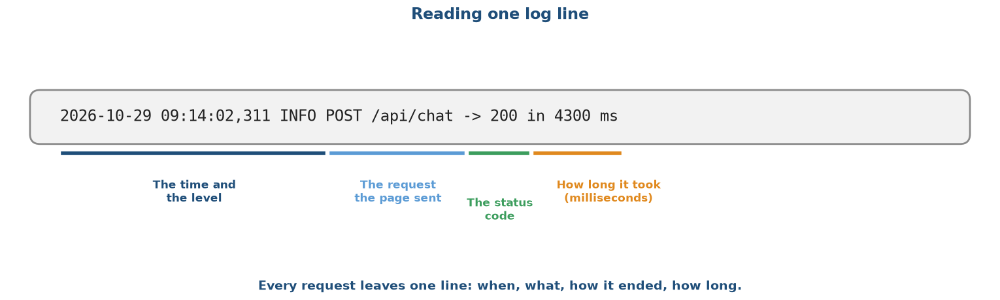

**Learning objectives.** Say what a system should log and what it must never log, add logging for usage, response time and errors, read a log to find failed and slow requests, and fix each problem one layer and one change at a time.

**Where we left off.** The test sheet shows what fails. A log shows why, and it keeps the evidence of what really happened while nobody was watching.

## 2.1 What to log, and adding it

A **log** is a text file where a program writes what it did. Think of the black box of an aeroplane: nobody reads it on a good flight, but it is the first thing opened when something goes wrong. Without one, "it was slow yesterday" cannot be checked. Adding code that records what a system does is called **instrumenting** it.

| Measure | It answers | Where it shows |
|----|----|----|
| **Usage** | How many questions came in, and which tools they used | One `POST /api/chat` line per question, and a `tools=` line |
| **Response time (latency)** | How long a request took, in milliseconds | The number before `ms` |
| **Errors** | What failed, and why | A 500 status, and an `ERROR` line with the details |
| **Never** | Keys, passwords or personal data | Anyone who can read the log can read them |

Each line carries a **log level**: INFO for a normal event, ERROR for a failure. A file that only grows would one day fill the disk, so the log is **rotated**: when it reaches 1 MB a new file starts, and three old ones are kept. The scheduler already writes its own `data/run.log` (Day 1, 3.4); the back end gets `logs/app.log`. A function that runs around every request, before and after the route, is called **middleware**. It reads the clock, passes the request on, reads the clock again and writes one line.

▶ **Do it:** press Tab for the **Build** agent, press `ctrl+x` then `n` for a new chat, and send. The check comes first:

> **Add logging to the back end. First write two checks and show me they fail.**
>
> Check 1. A request with a wrong key writes an ERROR line with the details, and the key never appears in the log.
>
> Check 2. Every chat request writes one line with the method, the path, the status and the time in milliseconds, and a second line that names the tools used.
>
> Back end: write to logs/app.log, rotate at 1 MB and keep three old files. Log usage, response time and errors. Show a short message on the page and the full details only in the log.
>
> Data: log no keys and no personal data. Build until both checks pass. Don't change anything else.

**What to look for:** (1) both checks fail first and pass at the end; (2) after one question in the page, `logs/app.log` has a line like `2026-10-29 09:14:02,311 INFO POST /api/chat -> 200 in 4300 ms` and a line with `tools=`; (3) searching the log for the text of your key finds nothing.

Your own prototype needs the same lines. Send the same prompt in its project, and add the facts you will want later to each INFO line: the tools used and the number of records. A script with no web back end, such as a scheduled agent, only needs one line per run in its own log, as the scheduler has in `data/run.log`.

## 2.2 Reading the logs for failed and slow requests

A log helps only when someone reads it. Each line has the same four parts.

<Frame caption="Figure 2.1: one request, one line: the time, the request, the status and how long it took.">
  
</Frame>

| What you see | What it means | Where to look next |
|----|----|----|
| `-> 400` | The request was empty or wrong | The page, or whatever called the back end |
| `-> 500` **with an** `ERROR` **line** | The agent or a tool failed | The details under the ERROR line, such as a wrong key |
| `-> 200` **with a large** `ms` | Correct but slow | The `tools=` line above it: more tools mean more steps and more waiting |
| `-> 404` **on** `/favicon.ico` | The browser asked for a site icon | Nothing. It is harmless |
| **The page shows 502 and no new line** | The request never reached the back end | The back end is not running (4.3) |

▶ **Do it:** send to **Build**. You do not need the commands: OpenCode picks them (the common ones are in Appendix A):

> **Search logs/app.log and show me: every failed request, every request slower than 10 seconds, how many questions came in, and the tools used per question.**
>
> Back end: read the log only. Then ask three questions in the page, including an empty one, and show me the new lines.
>
> Data: change nothing.
>
> Don't change any file.

**What to look for:** the empty question gives `-> 400 in 2 ms`; a question that needs three tools is the slowest, because every extra tool is another step. Decide what slow means before you test: 10 seconds is a fair first limit. **Monitoring** is reading the log on a regular schedule, and a daily look answers three questions: how many questions came in, did any fail, and which was slowest.

## 2.3 Fixing what you find

Every finding follows the same loop: (1) repeat the input that failed, so you see the problem yourself; (2) find the layer that caused it, because the status code and the log say where to look; (3) change one thing in that layer; (4) run the whole test sheet again; (5) write the fix next to the row. Fix the layer that caused the problem, not the layer where it shows. A wrong number on the page is often a data or prompt problem and never a page problem.

| Symptom | Layer | Typical fix |
|----|----|----|
| **A wrong number in the answer** | Data or agent | Compare with the tool result; add the rule that every number comes from a tool |
| **The wrong tool was chosen** | Agent | Sharpen the tool description (Day 2, Session 1) |
| **A question outside banking is answered from memory** | Agent | Add a rule that says what the assistant answers and what it declines |
| **Error 500 for a ticker that does not exist** | Data | Catch the error inside the tool and return "no data" |
| **Very slow answers** | Agent or data | Fewer tools, tighter descriptions, find the slow tool |
| **The page shows nothing after an error** | Interface | Open the browser console with F12 and read the message |

▶ **Do it:** press Tab for the **Plan** agent, press `ctrl+x` then `n` for a new chat, and send:

> **Use the systematic-debugging skill. Read the failed rows of docs/test_sheet.md and the matching lines of logs/app.log.**
>
> For each failure, name the layer that caused it and propose one change. Order them by the earliest broken step.
>
> Don't change any file.

Approve the plan, then fix one row at a time.

▶ **Do it:** press Tab for the **Build** agent and send:

> **Fix the first failure in your plan, and only that one.**
>
> Back end: write its check first and show it fails. Change one thing in the layer you named, then run the whole test sheet again.
>
> Data: write the fix in the Fix needed column of that row.
>
> Don't change anything else.

**What to look for:** the row now passes, and **no other row broke**: a fix for row 5 must not break row 1. Repeat for each failure. Typical results: rows 5 and 6 pass after a rule in the system prompt and a "no data" message in the tool.

**Quick check.** Say your answer to your neighbour first, then compare: (1) A page shows a wrong number but the tool result is right. Which layer do you fix? (2) The log shows `-> 200 in 31200 ms`. Is the answer wrong? (3) Why must the log never hold a key?
