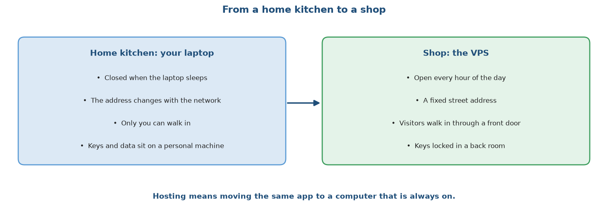

**Learning objectives.** Explain why the app is stuck on your laptop, say what hosting is and what a hosted app needs, compare a laptop with a VPS, and prepare the deployment files for the server.

**Big question.** What has to be true for a colleague to open your app at any hour?

## 3.1 From your device to other people's devices

The app works, and it is stuck. The page opens at `http://localhost:5173`. The name **localhost** means this computer, so only your own browser can open that address. A colleague who types it opens their own computer, where nothing is running. Other people cannot reach the app, it stops when the laptop sleeps, and the keys and data stay on a personal machine. To change that, the app has to be hosted.

## 3.2 What hosting is, and what it needs

**Hosting** means running a program on a **server**, a computer that other people can reach over a network and that waits for requests and answers them. The program is the same React page, the same back end and the same scheduler you built. Only the place where they run changes. In short, hosting needs a device that is online all the time.

| Need | Meaning |
|----|----|
| **Always on** | The computer stays powered and awake, so the app answers at any hour |
| **A network connection** | It is connected to the network its users are on |
| **A stable address** | The address does not change, so links keep working |
| **A running program** | The back end and the scheduler run, and restart after a crash or a reboot |
| **A way in for users** | A web server takes requests from browsers and passes them to the right program |

## 3.3 Laptop or VPS

You could keep a laptop switched on all the time. The better choice is a **VPS**, a virtual private server: a computer in a data centre that you control from another machine. It is a virtual machine inside a larger physical one, with no screen and no keyboard, so you work on it through a command line. Moving from a laptop to a VPS is moving from a home kitchen to a shop.

<Frame caption="Figure 3.1: the laptop is a home kitchen, the VPS is a shop with fixed opening hours and a street address.">
  
</Frame>

|  | Laptop or PC kept on | VPS |
|----|----|----|
| **Always on** | Sleeps, restarts for updates, depends on the power at your desk | Stays on in a data centre |
| **Address** | Changes when the network changes | Fixed |
| **Reachable by others** | Depends on the office router and firewall | Set up for network access |
| **How you work on it** | With a screen and a keyboard | Through a remote command line, SSH (4.1) |
| **Operating system** | A desktop system | A server system without a desktop |

This course deploys to your own VPS. It runs Ubuntu 22.04 or newer (or Debian 12 or newer) and installs software with `apt`.

## 3.4 Prepare the project for the server

Before you touch the server, ask the consultant to map what has to move. Reading is safe, so the Plan agent can do it freely.

▶ **Do it:** press Tab for the **Plan** agent, press `ctrl+x` then `n` for a new chat, and send:

> **Explain what my app needs to run on a VPS that other people can open.**
>
> List each part of the project: the React page, the back end, the scheduler, the keys, the saved data and the logs. For each, say where it lives on my laptop and where it will live on the server, in plain words.
>
> Don't build yet.

**What to look for:** six parts. The page becomes the plain files of `dist/` and **needs no Node.js on the server**; the back end and the scheduler are Python programs; `.env` travels over a secure connection and never goes into Git; `data/`, `reports/`, `raw/`, `wiki/` and `prompts/` move because the app reads them; the logs are written on the server.

Now the Build agent writes the deployment files into a `deploy/` folder. Nothing is sent anywhere yet, and the checks come first.

▶ **Do it:** press Tab for the **Build** agent, press `ctrl+x` then `n` for a new chat, and send:

> **Prepare the deployment files in a deploy/ folder. Before building, write three checks as test files and show me they fail.**
>
> Check 1. The web server file forwards /api to port 8000. Check 2. Both service files run as www-data and restart 3 seconds after a crash. Check 3. No file in deploy/ contains any text from .env.
>
> Front end: a web server file that serves the built page from dist/ on port 80 and forwards every request that starts with /api to the back end, waiting up to 120 seconds for the agent.
>
> Back end: two service files, one for the back end (uvicorn on 127.0.0.1 port 8000) and one for the scheduler, both running as www-data in /opt/idx-assistant. Add requirements-server.txt.
>
> Data: the scheduler keeps the Asia/Jakarta time zone. Build until the three checks pass. Connect to no server yet.

**What to look for:** (1) the three checks fail first and pass at the end; (2) `deploy/` holds an nginx file, two service files and `requirements-server.txt`; (3) no key appears in any of them. Ask OpenCode to explain one line of each file in plain words: you should hear "serves the page", "forwards /api" and "starts again after a crash".

**Quick check.** Say your answer to your neighbour first, then compare: (1) Why can a colleague not open `http://localhost:5173`? (2) Name three things a hosted app needs. (3) Why does the server need no Node.js?
