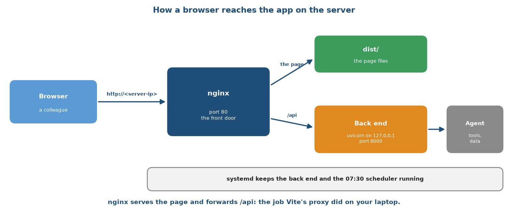

**Learning objectives.** Log in to a server with a key, copy the built page and the back end to it, keep the back end and the scheduler running as services, open the app through nginx, explain what a domain adds, and confirm that the server writes its own logs.

**Where we left off.** The deployment files are ready and nothing has left your laptop. Today OpenCode runs each step on a real server. Participants check each one.

## 4.0 Start: the rules for a real server

A server is not a project folder. A wrong command can delete things for everyone. The guardrail from Day 1 (1.6) applies with full force: **reading is safe; acting needs approval.**

▶ **Do it:** press Tab for the **Build** agent, press `ctrl+x` then `n` for a new chat, and send:

> **Add a section called Servers to AGENTS.md. Keep everything that is already there.**
>
> Reading is safe: you may run commands that only look, such as listing files, showing a status or reading a log. Anything that installs, copies, deletes, restarts or changes permissions must be shown to me first and runs only after I approve it.
>
> Never print the contents of .env. Never type a password: I type it myself in my own terminal. Never copy .env into Git.
>
> Don't change any other file.

**What to look for:** `AGENTS.md` has the Servers section. From now on, OpenCode asks permission before each command that acts. **Read every command before you approve it.**

## 4.1 Remote access with SSH

The VPS has no screen, so you reach it from your laptop. **SSH**, Secure Shell, opens an encrypted command line on another computer. In `ssh root@<server-ip>`, `root` is the administrator account on the server and `@` reads as "at". Files travel over the same connection with `scp`, Secure Copy. A password can be guessed, so you log in with a **key pair** instead: a private key that stays on your laptop, like the key to your house, and a public key that you put on the server, like a lock that fits only that key.

▶ **Do it:** send to **Build**:

> **Check whether I already have an SSH key. If not, make a new key pair for this course. Show me only the public key.**
>
> Back end: never print the private key. Then tell me the one command I must run myself to put the public key on the server, because I type the password in my own terminal and never in this chat.
>
> Data: change nothing on the server. Don't connect yet.

▶ **Do it:** open a normal terminal window, run the command OpenCode gave you, and type your server password when asked. Then, back in OpenCode, send:

> **Log in to the server with the key and run only commands that look: show the system release and the Python version. Change nothing.**

**What to look for:** the server runs Ubuntu 22.04 or newer (or Debian 12 or newer) and Python 3.10 or newer. If OpenCode asks for a password, the key was not installed: repeat the terminal step.

## 4.2 Build, copy and keep the keys safe

Now the real move. The built page is a folder of plain files, so only `dist/` travels, not `node_modules`. The back end, the scheduler and the saved data travel too. The keys follow three rules: the file travels over the encrypted connection and never goes into Git; only the service user can read it; and a new key takes effect only after the back end restarts, because it reads the file once at startup. The code is identical on the laptop and on the server; only settings such as keys differ, and they live in `.env`.

▶ **Do it:** send to **Build**:

> **Build the page and copy the project to the server. Show me each command before you run it.**
>
> Front end: run the production build of the React page in frontend/ and copy the dist/ folder to /opt/idx-assistant/dist on the server.
>
> Back end: copy the back end, the scheduler, requirements-server.txt and the .env file over the encrypted connection, then make .env readable only by its owner.
>
> Data: copy only what the app reads: data/, reports/, raw/, wiki/ and prompts/. Do not copy node_modules, .git or tests.
>
> Don't print .env and don't change anything else.

**What to look for:** (1) the server folder `/opt/idx-assistant/` holds `backend/`, `dist/`, `data/`, `reports/`, `raw/`, `wiki/`, `prompts/` and `.env`; (2) `.env` shows permissions `-rw-------`; (3) there is no `node_modules/` and no `.git/`; (4) you read and approved each command, and none of them printed a key.

## 4.3 Keeping the back end running

On your laptop the back end stops when you close its window. On a server it must keep running with nobody logged in. A **managed process** does this: a process manager starts it, watches it and starts it again after a crash. The course uses **systemd**, built into most Linux servers ("system daemon": a daemon is a program that runs in the background), controlled with `systemctl`, "system control". The back end and the scheduler both become services.

| What systemd does | Result |
|----|----|
| **Starts both programs when the server boots** | The app is back after a server restart |
| **Restarts a program 3 seconds after a crash** | A failure lasts a few seconds |
| **Collects what the programs print** | `journalctl` shows it |
| **Runs them as the user** `www-data`**, with no login and no admin rights** | A bug has limited access to the system |

▶ **Do it:** send to **Build**:

> **Set up and start the back end and the scheduler as services on the server. Show me each command before you run it.**
>
> Back end: install the Python tools, make a private environment in /opt/idx-assistant, install requirements-server.txt, give the folder to www-data, install the two service files from deploy/, then enable and start both. Test the back end by hand first with a health check.
>
> Data: the scheduler reads and writes data/ and reports/ in the same folder and keeps the Asia/Jakarta time zone.
>
> Don't open the app to the internet yet.

**What to look for:** (1) both services show `active (running)`; (2) the health check answers `{"status":"ok"}`; (3) the scheduler's next run is a weekday at **07:30 WIB**. A server often runs on UTC: without a stated time zone, 07:30 would arrive at 14:30 in Jakarta (Day 1, 4.2).

Test the restart. A service that restarts is the whole point.

▶ **Do it:** send to **Build**:

> **Stop the back end process, wait four seconds and show me the service status.**
>
> Back end: the process id must change. Change nothing else.

**What to look for:** the status shows `active (running)` again with a **new process id**.

## 4.4 How a browser reaches the server

Think of a building with a reception desk. A visitor never walks into the back office. The receptionist either hands over the brochure (the page) or sends the visitor to the right office (the back end). That receptionist is **nginx**, pronounced "engine x", a web server that works as a **reverse proxy**: it sits at the entrance and decides where each request goes. A browser needs two things to find the app: the **IP address** of the server, the number that identifies a computer on a network, and the **port**, a numbered entrance on that computer. Port 80 belongs to nginx and port 8000 to the back end.

| Term | Meaning | In this course |
|----|----|----|
| **IP address** | The number that identifies a computer on a network | The address of your VPS |
| **Port** | A numbered entrance on a computer | 80 for nginx, 8000 for the back end |
| **Domain** | A name that points to an IP address (4.5) | Optional: without one, the page opens by IP address |

<Frame caption="Figure 4.1: a browser asks nginx for the page and for /api; the back end listens on 127.0.0.1, so only nginx can reach it.">
  
</Frame>

▶ **Do it:** send to **Build**:

> **Put nginx in front of the app. Show me each command before you run it.**
>
> Front end: install the nginx file from deploy/, turn it on, remove the default site and check the file before reloading.
>
> Back end: the back end stays on 127.0.0.1 port 8000. If the firewall is active, allow port 80 and nothing else.
>
> Data: change nothing else. Then tell me the address to open.

▶ **Do it:** open `http://<server-ip>` in your browser and click an example question. Then try `http://<server-ip>:8000`.

**What to look for:** (1) the nginx check says `syntax is ok`; (2) the React page appears and answers "How did NISP close on 23 Oct 2026?" with **Rp 1.185**; (3) `:8000` does **not** open from outside: the back end is reachable only through nginx. A 502 on a question means nginx cannot reach the back end (check the service); a page that shows the old version needs Ctrl+F5.

## 4.5 Why have a domain

Without a domain, users type a number such as `http://203.0.113.25`. A **domain** is a name that points to that address, and **DNS**, the Domain Name System, does the pointing like a phone book: you look up a name and get a number.

| Without a domain | With a domain |
|----|----|
| **Users type a number, hard to remember and to say in a meeting** | Users type `assistant.example.com` |
| **If the server changes address, every saved link breaks** | You change one DNS record and every link keeps working |
| **One address serves one app** | One server can serve several apps, each under its own name |

A domain needs three things: a registered name (from a registrar, or from whoever manages domains in your organisation); an **A record**, the DNS record that connects the name to the server's IP address, which can take minutes to hours to spread; and the name in the nginx file, in the `server_name` line. The course does not set up `https`, but a domain is its first step. A domain is optional today: if your trainer gives you one, ask Build to put it in the nginx `server_name` line, check the file and reload nginx.

## 4.6 Confirm the logs, and update after a change

A deployment is not finished until the server writes its own logs. The back end keeps two: `logs/app.log`, with the request lines and the error details, and the systemd journal, with the start and stop messages and everything the programs print. You read the journal with `journalctl`, one service at a time.

▶ **Do it:** ask a question in the page, then send to **Build**:

> **Show me the last 5 lines of logs/app.log and the last 10 lines of the journal for both services. Then ask an empty question in the page and show me the new lines.**
>
> Back end and data: read only, change nothing.

**What to look for:** a new `POST /api/chat` line and a `tools=` line with the time of your question; for the empty question a 400 line; both services running in the journal. No line at all means the request never reached the back end (check the services and nginx); a 500 with an ERROR line usually means a missing or wrong key in the server's `.env`.

▶ **Do it:** **Try it:** break it on purpose. Send to **Build**:

> **Put a wrong key in the .env on the server, restart the back end, ask one question in the page, then show me the page, the log and the journal. Put the right key back afterwards and restart.**
>
> Back end and data: show me each command first, and never print any key.

**What to look for:** the page shows a short error, never a key; `logs/app.log` has a `-> 500` line and an `ERROR` with the details; the journal shows the service still running. A new key takes effect only after a restart (4.2). Check the right key is back by asking the NISP question again.

From here, every check of Session 1 applies on the server. Run the test sheet against the server address.

▶ **Do it:** send to **Build**:

> **Run the whole test sheet again, this time against the server address, in a new Result column.**
>
> Back end: read the log after each row. Row 9 runs on a copy, never on the real .env.
>
> Data: change nothing on the server. Don't fix anything yet.

**What to look for:** the same rows pass as on your laptop. Any difference is a deployment problem: compare with the laptop run. When you change the app later, only the changed part travels (Appendix A.4).

**Quick check.** Say your answer to your neighbour first, then compare: (1) Which program listens on port 80, and which on port 8000? (2) The page loads but shows 502 on a question. Where do you look first? (3) Why is the back end bound to 127.0.0.1?
