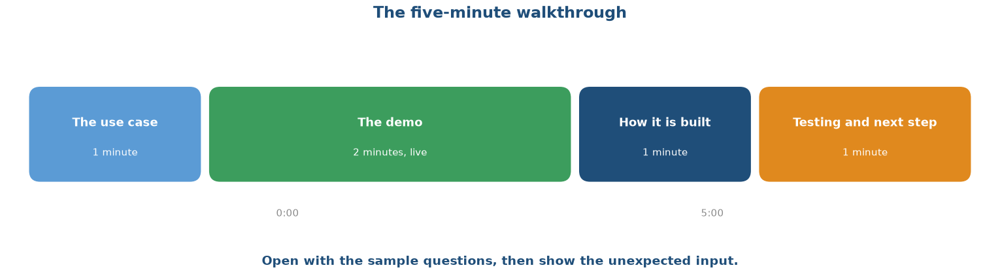

**Learning objectives.** Answer four questions about your project in a few minutes, build a five-minute walkthrough, and run the safety checks before you share a link.

**Big question.** How do you show a system so that peers trust it?

## 5.1 Preparing to share

A good share answers four questions. Prepare one short answer for each. The system you present is the capstone or your own prototype: the steps are the same.

| Question | What to prepare |
|----|----|
| **What problem does it solve?** | One sentence naming who asks what, and why it matters. For example: "Finance staff need to know why bank shares moved, in seconds." |
| **What does it do?** | A live demo with two or three sample questions and one unexpected input |
| **How is it built?** | One line each: the data source, the tools, the agent, the interface, where it runs |
| **What did testing show?** | One failure you found, how you found it in the test sheet or the log, and how you fixed it |

Also prepare what does **not** work yet: a clear list of limits is more useful to peers than a claim to do everything.

## 5.2 A five-minute walkthrough

<Frame caption="Figure 5.1: five minutes: one for the use case, two for the live demo, one for how it is built, one for testing and the next step.">
  
</Frame>

| Step | What to show for the capstone |
|----|----|
| **The use case** | The finance team and the questions they ask |
| **The demo** | "How did NISP close on 23 Oct 2026?" (Rp 1.185); "Why did bank stocks fall in mid October 2026?" with sources; then one unexpected input, such as the empty message or the ticker ABCD |
| **How it is built** | The layers and the tools, from the test sheet and the four-day pattern (6.3) |
| **What testing found** | One fix, and the next step you plan |

Open the demo with the sample questions, because they show the system at its best. Then send the unexpected input, because it shows what you did to make the system reliable. If something fails during the demo, open the log: showing how you find the cause is part of the walkthrough.

▶ **Do it:** press Tab for the **Plan** agent, press `ctrl+x` then `n` for a new chat, and send:

> **Interview me about my five-minute walkthrough, one question at a time. When I say the script is complete, write it.**
>
> Front end: which two sample questions and which unexpected input to show on the page.
>
> Back end and data: the failure I found and fixed, the limits I will name and the saved numbers I will quote. Save nothing yet.

Answer with specifics (Day 1, 2.5), then save the script.

▶ **Do it:** press Tab for the **Build** agent and send:

> **Save the script as docs/walkthrough.md, with a timing for each step and a list of what does not work yet.**
>
> Don't change any other file.

**What to look for:** a script of five timed steps, a failure with its fix, and a short list of limits. Rehearse once with a timer: it should end at five minutes.

## 5.3 Safety checks before you share a link

A link travels further than you plan. Read through the checks once, then let OpenCode do the looking.

| Check | Pass when |
|----|----|
| **Keys** | No key in any file the browser loads, in the log or in Git |
| **Data** | Only public market data and made-up company data are on the server |
| **Advice** | The page shows the no-investment-advice note, and no answer says buy, sell or hold |
| **Access** | `:8000` is closed, and `.env` is private on the server |
| **Actions** | Anything that saves or sends still waits for approval (Day 2, Session 3) |

▶ **Do it:** send to **Build**:

> **Check the deployed app against the six safety checks, and show me the result for each.**
>
> Front end: show me every file the browser loads and confirm that none contains a key. Confirm that the no-advice note is on the page.
>
> Back end: confirm .env is private and not in Git, and that the back end answers only through nginx.
>
> Data: confirm only public market data and made-up Harapan Mitra Niaga data are on the server. Read only.
>
> Don't change anything.

**What to look for:** six passes. A failure goes on the test sheet and is fixed before you share the link.

**Quick check.** Say your answer to your neighbour first, then compare: (1) What are the four questions of a good share? (2) Why open the demo with sample questions and not with the unexpected input? (3) Which safety check protects the keys?
