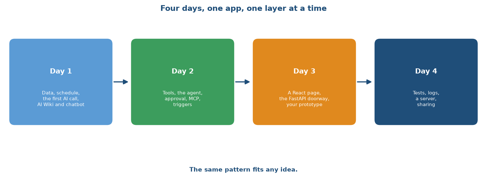

**Learning objectives.** Present your system to peers, give and use feedback, choose the next step and its owner, and see how the four days fit into one pattern you can repeat on any idea.

## 6.1 Giving and using feedback

Peers see the system the way a new user does. Ask them for specific things instead of "what do you think?".

| Ask peers | Why |
|----|----|
| **Which question do you ask this system first?** | It shows the use the builder did not plan for |
| **Where did the answer surprise you?** | It points to a quality check that is missing |
| **What do you need before you use it every day?** | It shows the gap between a prototype and a daily tool |

▶ **Do it:** present your five-minute walkthrough from `docs/walkthrough.md` to a small group, then listen to each peer's presentation. While you listen, write each piece of feedback on a list and mark the **layer** it belongs to: data, tools, agent, interface or hosting (2.3).

▶ **Do it:** send to **Build**:

> **Turn my feedback list into docs/next_steps.md, grouped by layer, with the earliest layer first.**
>
> Data: my feedback list, pasted under this message. Mark each item as a quick fix or a bigger change. Save only that file.
>
> Don't change any other file.

**What to look for:** a file grouped by layer. A wrong number on the page goes under data or agent, never under interface. The list becomes the plan for the next version.

## 6.2 Discussing next steps

| Direction | What it means | Where it builds |
|----|----|----|
| **More data** | Add tools for more Sectors endpoints or another source | Data layer and tools, Days 1 and 2 |
| **More automation** | Run reports or alerts on a schedule | Automation, Days 1 and 2 |
| **Better answers** | Turn the failures on the test sheet and in the log into prompt and tool fixes | Agent layer, Day 4 (1.4, 2.3) |
| **A better page** | Add what peers asked for, such as a new example question or a table of results | Interface, Day 3 |
| **More users** | Watch response time and failed requests in the log as use grows | Hosting, Day 4 (3 and 4) |

Choose **one** next step and **one** owner for it. A prototype improves when each round ends with a short list of changes.

## 6.3 Four days, one pattern

Over four days the Harapan Mitra Niaga assistant grew one layer at a time.

<Frame caption="Figure 6.1: each day added the layer the next one stands on.">
  
</Frame>

| Layer | Day | What you built |
|----|----|----|
| **Data** | Day 1 | Saved Sectors prices, news, cash flow and the AI Wiki |
| **Automation** | Days 1 and 2 | A 07:30 WIB report, and a trigger that wakes the agent |
| **Agent** | Day 2 | Tools, an agent that picks them, approval before actions, MCP |
| **Interface** | Day 3 | A React page and a FastAPI doorway in front of the agent |
| **Testing and logging** | Day 4 | A test sheet, quality checks and a log of usage, time and errors |
| **Hosting and sharing** | Day 4 | A server with nginx and systemd, and a five-minute walkthrough |

The same pattern fits any idea, and it has five steps: (1) put the data behind tools; (2) give the tools to an agent; (3) put a page in front of the agent; (4) test it and watch its log; (5) run the whole thing on a server that stays on. Throughout, you described, the AI built and you checked.

**Quick check.** Say your answer to your neighbour first, then compare: (1) Which layer does a wrong number on the page usually belong to? (2) What are the five steps of the pattern? (3) What is your one next step, and who owns it?

**Preview:** after the course, keep the habit: write the expected result first, keep the log, and change one layer at a time. Take your `AGENTS.md`, test sheet and `docs/next_steps.md` with you, and start your next idea at the lowest rung of the control ladder that works.
